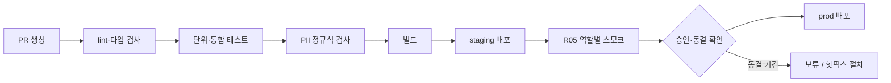

# B04 인프라·배포설계서

> **작성 가이드**
> - **목적**: B01 시스템을 어디에, 어떻게 배포·운영·복구하는지 정합니다. 학사일정에 맞춘 변경 동결과 개인정보 사고 대응을 포함합니다.
> - **입력**: B01 구성 요소·비기능 요구·기술 선택, E13 RK·(a) 국외 이전 판정, E15 변경 동결(FZ)·마일스톤, [[domain/학사일정]]
> - **게이트**: 전제는 B01, E13. 회사 인프라 표준이 있으면 `n/a`. 리전·국외 이전·사고 신고 기한은 법무 확인 전까지 `[확인 필요]`로 둡니다. 비용 수치는 계산식과 `[가정]`을 함께 적습니다.
> - **작성 스킬**: `/edpm-doc B04`
> - **검토 패널 (권장)**: 개발 리드, 보안 담당, 개인정보 보호책임자, 운영(CS) 담당, 재무(비용)
> - 표의 첫 행은 예시 제품 **매스핏**(중학생 만 12~15세, 학원 B2B2C + 학부모 결제, AI 오답 해설) 기준입니다. 제품명·서비스명은 예시이며 특정 업체를 권장하지 않습니다.

---

## 1. 환경

| 환경 | 용도 | 데이터 | 접근 | 예시 (매스핏) |
|------|------|--------|------|---------------|
| local | 개발 | 가상 시드만 (B03 7절) | 개발자 | 로컬 DB + 시드 스크립트 |
| staging | 통합·QA·R05 스모크 | 가상·가명 데이터만 | 팀 + 테스트 계정 | 배포마다 자동 갱신, 외부 접근 차단 |
| prod | 운영 | 실제 데이터 | 최소 인원, 접근 로그 | 국내 리전 [확인 필요] |
| {환경} | {용도} | {데이터} | {접근} | {예시} |

## 2. 배포 파이프라인

| 단계 | 내용 | 실패 시 |
|------|------|---------|
| lint·테스트 | {도구}. B06 P0 자동화 TC 포함 | 병합 차단 |
| PII 정규식 검사 | 코드·시드·픽스처·로그 샘플에서 휴대폰 번호, 이메일, 주민등록번호 형태, 실명 목록 패턴 탐지 | 병합 차단, 오탐은 허용 목록에 사유와 함께 등록 |
| 비밀값 검사 | API 키·토큰 패턴 탐지 | 병합 차단, 키 즉시 교체 |
| 동결 확인 | 배포일이 E15 FZ 기간인지 확인 | 핫픽스 절차로만 진행 |
| 롤백 | {방법, 목표 시간} | 예시: 직전 배포로 즉시 되돌리기, DB 마이그레이션은 되돌릴 수 있게 작성 |

## 3. 호스팅·리전·데이터 상주

| 대상 | 위치 | 국외 이전 여부 | 근거 | 예시 (매스핏) |
|------|------|:---:|------|---------------|
| 웹·API | {업체, 리전} | {예/아니오} | | 예시: 엣지 배포 + 서버 함수 국내 리전 [확인 필요] |
| 운영 DB | {업체, 리전} | {예/아니오} | E13 a7 | 국내 리전 [확인 필요] |
| 백업 | {위치} | {예/아니오} | | |
| LLM API | {업체, 처리 국가} | {예/아니오} | E13 a6·a7 | 해외 처리 시 고지·동의 요건 [확인 필요] |
| 알림·분석 | {업체} | {예/아니오} | | |

학교·교육청 계약은 별도 보안 심사·클라우드 요건이 있을 수 있습니다 [확인 필요] (E13 a10).

## 4. 비밀값 관리

| 규칙 | 내용 |
|------|------|
| 저장 | 호스팅 환경 변수 또는 비밀 저장소. 저장소·문서·위키에 값 기록 금지 (`.env*`, `*.key`, `secrets/`는 `.gitignore`) |
| 분리 | 환경별로 다른 키. staging에 prod 키 사용 금지 |
| 교체 | {주기}, 퇴사·유출 의심 시 즉시 |
| 접근 | {인원·역할}, 접근 기록 |

## 5. 백업과 복구

| 항목 | 기준 | 예시 |
|------|------|------|
| 백업 주기·보관 | {주기, 보관 기간} | 일 1회 + 시점 복구, 보관 기간은 E12 파기 정책과 충돌 없게 [가정] |
| 복구 목표 | RPO {N}, RTO {N} | RPO 24시간, RTO 4시간 [가정] |
| 복구 테스트 | {주기}, 결과를 `01.자료실/데이터/`에 기록 | 학기 시작 전 연 2회 |
| 파기 반영 | 삭제 요청 처리분이 백업에서 언제 사라지는지 명시 | 백업 보관 기간 경과 시 [확인 필요] |

## 6. 모니터링·알림

| 지표 | 임계값 | 알림 대상 | 예시 |
|------|--------|-----------|------|
| API 오류율 | {N}% / 5분 | {당번} | 2% [가정] |
| 힌트 응답 p95 | {N}초 | {당번} | 3초 초과 (F-012 비기능 기준) |
| 정적 힌트 대체 비율 | {N}% | AI 담당 | LLM 장애 조기 감지 |
| 권한 거부(403) 급증 | {N}건 | 보안 담당 | 권한 오류 또는 무단 조회 시도 |
| 비용 | 일 {N}원 | PM·재무 | LLM 호출 비용 급증 |

## 7. 학사일정 변경 동결

E15 8절 변경 동결(FZ)과 [[domain/학사일정]]을 따릅니다.

| FZ-ID (E15) | 기간 | 사유 | 허용 예외 | 사전 조치 |
|-------------|------|------|-----------|-----------|
| FZ-01 (예시) | 2027-04-19 ~ 05-07 | 중학교 1학기 중간고사 | 보안 패치, 오답 해설 오류 수정 | 동결 1주 전 부하 테스트, 용량 증설 |
| {FZ} | {기간} | {신학기 첫 2주 / 시험 기간 / 수능} | {예외} | {조치} |

## 8. 사고 대응

| 등급 | 예 | 첫 대응 | 보고 |
|------|----|---------|------|
| S1 개인정보 유출·의심 | 다른 반 학생 기록 노출, DB 접근 키 유출 | 즉시 차단·키 교체·증거 보존 | 개인정보 보호책임자 즉시, 정보주체(보호자) 통지·기관 신고 기한 [확인 필요] |
| S2 학습 기능 중단 | 학기초 피크 장애 | 상태 공지, 롤백 | 학원 원장·교사 공지 |
| S3 부분 기능 오류 | AI 힌트 장애 (정적 힌트로 대체) | 모니터링 | 주간보고 |

**개인정보 유출 신고 절차 [확인 필요: 현행 법령의 신고 대상·기한·기관]**

1. 탐지 → 당번이 S1 선언, 개인정보 보호책임자 호출
2. 확산 차단 (접근 차단, 키 교체), 로그·증거 보존
3. 영향 범위 산정 (대상 learner 수, 항목) — 스크립트로 계산
4. 법무 검토 → 신고·통지 여부와 기한 결정
5. 보호자·기관 통지 문구 (쉬운 말), 재발 방지 조치, 사후 보고서를 `04.ops/`에 기록

## 9. 비용 추정

| 항목 | 계산식 | 입력값 | 월 비용 | 근거 |
|------|--------|--------|---------|------|
| LLM 호출 (예시) | 월 활성 학습자 × 일 힌트 요청 × 학습일 × 요청당 단가 | 1,000명 × 5회 × 20일 × {단가} [가정] | {계산} | 업체 단가표 [확인 필요] |
| 호스팅 | {요금제 + 초과분} | {입력} | {계산} | |
| DB | {요금제 + 저장량} | {입력} | {계산} | |
| 알림 | 발송 건수 × 단가 | {입력} | {계산} | |
| **합계** | | | {합계} | 계산은 스프레드시트·스크립트 `{경로}` |

## 10. 단계별 아키텍처

| 항목 | M1 단계 (MVP·파일럿) | 확장 단계 |
|------|----------------------|-----------|
| 규모 | 예시: 학원 3곳, 학습자 수백 명 [가정] | {기관·학습자 수} |
| 구성 | 단일 앱 + 관리형 DB + 관리형 인증 | 학습 엔진·AI 게이트웨이 분리, 큐, 읽기 복제본 |
| 연동 | CSV 명단 가져오기 | OneRoster, LTI 1.3, SSO |
| 운영 | 개발자 당번 | 당번 순환, 상태 페이지 |
| 전환 조건 | {피크 동시접속, 비용, 계약 요건} | |

---

## 완료 체크리스트

- [ ] staging·local에 실제 학생 데이터가 없다
- [ ] CI에 lint, 테스트, PII 정규식 검사, 비밀값 검사가 있고 실패 시 병합이 막힌다
- [ ] 리전·국외 이전 항목이 E13 a7 판정과 일치하고 `[확인 필요]`가 법무로 넘어갔다
- [ ] 복구 테스트 일정과 결과 기록 위치가 있다
- [ ] 변경 동결 기간이 E15 FZ와 일치한다 (G-CAL)
- [ ] 개인정보 유출 대응 절차와 담당이 정해졌다
- [ ] 비용 표에 계산식과 `[가정]`이 있다
- [ ] B01, E13이 `done`이다
