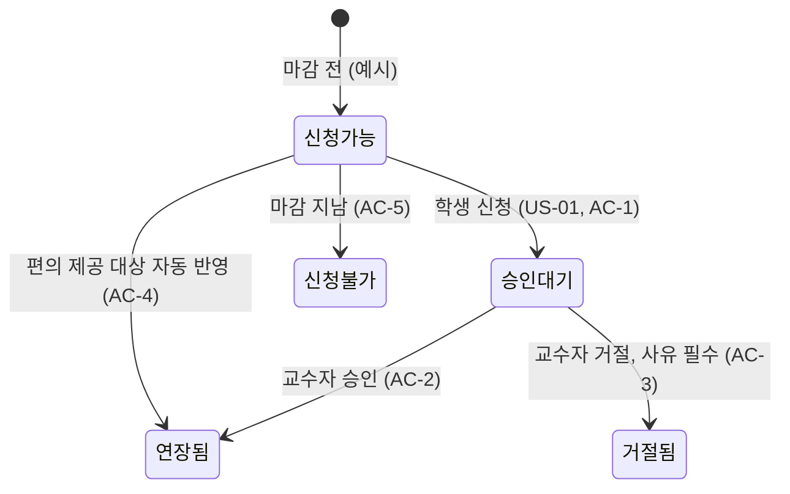

# F02 기능기획서 — {과제명}

> **작성 가이드**
> - **목적**: F01의 문제를 풀 기능을 정하고, 목표 지표·사용자 스토리·인수조건·화면·데이터 변경과 **영향 점검**을 한 문서에 담아 개발팀에 넘깁니다.
> - **입력**: F01 문제정의서, F00 기준선 지표·정책 기준(7절), E07·E10·E12·E13 등 기준 문서
> - **게이트**: **G-MEASURE** — 목표 지표에 기준선·목표값·SQL 경로가 없으면 완료할 수 없습니다. F01 유형이 **학습**이면 학습 지표 행도 채워야 합니다. 사용성·운영 과제는 학습 지표를 `n/a: 사유`로 둡니다. **G-IMPACT** — 5절 영향 점검표의 모든 행이 "해당없음(사유)" 또는 "조치 완료"여야 F03을 완료할 수 있습니다.
> - **분량**: 한두 쪽 (영향 점검표는 생략하지 않음).
> - **검토 패널 (권장)**: 개발 리드, 디자이너, 데이터 분석가, 개인정보 담당, CS 리드
> - **스킬**: `/edpm-doc feature spec`
> - 예시는 캠퍼스온 FI-007 "과제 제출 마감 연장 신청·승인 흐름"이며 수치는 [가정]입니다.

---

## 1. 목표와 목표 지표 (G-MEASURE)

목표: {한 문장} (예시: 학생은 마감 전 연장을 신청하고, 교수자는 한 화면에서 승인하며, 편의 제공 대상은 자동 반영된다)

| 구분 | M-ID | 지표 | 기준선 (기간) | 목표 | 판정 시점 | SQL |
|------|------|------|---------------|------|-----------|-----|
| 주 지표 | {M-xx} | {…} | {…} | {…} | {출시 후 N주} | `automation/sql/{…}.sql` |
| 학습 지표 | {학습 유형: 필수 / 사용성·운영: n/a: 사유} | {…} | {…} | {…} | {…} | {…} |
| 주 지표 (예시) | M-F71 | 연장 결정 소요 시간 중앙값 | 52시간 (2026-1학기) [가정] | 24시간 이하 | 출시 후 6주 | `automation/sql/FI007_연장결정시간.sql` |
| 주 지표 (사용성 예시) | M-F80 | 과제 제출까지 클릭 수 / 제출 완료율 | 3회 / 91% [가정] | 1회 / 95% | 출시 후 2주 | `automation/sql/FI012_제출흐름.sql` |

## 2. 사용자 스토리와 인수조건

| US | 역할 | 원하는 것 | 이유 |
|----|------|-----------|------|
| {US-01} | {…} | {…} | {…} |
| US-01 (예시) | 학생 | 과제 화면에서 사유를 골라 연장을 신청한다 | 메일 없이 공식 기록을 남기려고 |

| US | AC | Given | When | Then |
|----|----|-------|------|------|
| {US-01} | AC-1 | {전제} | {행동} | {관찰 가능한 결과} |
| US-01 (예시) | AC-1 | 마감 전이고 교수자가 연장 신청을 허용했다 | 학생이 사유와 희망 기한을 제출한다 | 신청 상태가 "검토 중"으로 보이고 교수자에게 알림이 간다 |

### 2.1 상태 흐름

상태가 둘 이상인 화면·처리는 Mermaid `stateDiagram-v2`로 그립니다. 정상 경로만이 아니라 빈 상태·실패·권한 없음·마감 지남 같은 분기를 넣고, 각 분기를 AC와 연결합니다. AI가 관여하면 E14 2.1 응답 흐름과 맞춥니다.

## 3. 화면 변경

| SCR | 화면 | 변경 전 | 변경 후 | 참고 패턴 (E10)·와이어프레임 |
|-----|------|---------|---------|-----------------|
| {SCR-xxx} | {…} | {…} | {…} | {…} |
| SCR-021 (예시) | 과제 상세 (학생) | 마감 시각만 표시 | "연장 신청" 버튼, 신청 상태 배지 | 학습자 앱 IA 패턴 |

## 4. 데이터·이벤트 변경

| 구분 | 이름 | 내용 | 개인정보 등급 | 기준 문서 |
|------|------|------|----------------|-----------|
| {이벤트/테이블/필드} | {EV-xx} | {…} | {일반/민감} | E12 |
| 이벤트 (예시) | EV-F71 extension_requested | 과제 ID, 신청 사유 분류, 희망 기한 | 일반 (사유 자유기술은 저장 안 함) | E12 |

## 5. 영향 점검표 (G-IMPACT)

> 모든 행을 판정합니다. "해당"이면 조치와 갱신할 기준 문서를 적고, 기준 문서를 실제로 갱신한 뒤 완료에 표시합니다.

| 영역 | 해당 여부 | 조치 | 갱신할 기준 문서 | 완료 |
|------|-----------|------|------------------|------|
| 개인정보·미성년 (E13) | {해당/해당없음: 사유} | {…} | {E13 a·b} | [ ] |
| AI 기능·평가 (E14 / A06) | {…} | {…} | {E14, A06 재평가} | [ ] |
| 가격·환불·정산 (P01 / S07) | {…} | {…} | {P01, S07} | [ ] |
| 진도·수료·평가 규칙 (L03 / L04) | {…} | {…} | {L03, L04} | [ ] |
| 교육과정 매핑 (E11, KG 커버리지) | {…} | {…} | {E11_교육과정매핑.csv} | [ ] |
| 접근성 (E13 c / B05) | {…} | {…} | {E13 c, B05} | [ ] |
| 콘텐츠 권리 (P02) | {…} | {…} | {P02} | [ ] |
| CS·공지 (P05) | {…} | {…} | {P05, CS 스크립트} | [ ] |
| 시즌 타이밍 (G-CAL) | {…} | {…} | {학사일정·성수기} | [ ] |
| 개인정보·미성년 (예시) | 해당: 장애 정보는 민감정보 (예시는 L04 지각 감점 기준일도 해당) | 교수자에게 사유 비공개, "편의 적용"만 표시 | E13 a3, L04 | [ ] |

## 5.1 입출력 계약과 작업 분해 (스펙 → 구현)

개발팀이 프로토타입이 아니라 이 표를 기준으로 구현하고, 인수조건이 곧 테스트가 되게 합니다. 기능 간·외부 시스템 사이에 오가는 것과 작업(T)을 적습니다. 작업 하나는 하루 이내, AC 하나 이상을 통과시키는 단위입니다. `/edpm-spec tasks`로 WBS·GitHub 이슈로 내보내고, 바이브코딩이면 `/edpm-spec build T-xx`로 구현합니다.

| 계약 ID | 주는 쪽 → 받는 쪽 | 형식 (필드·타입·단위) | 검증 방법 |
|---------|-------------------|------------------------|-----------|
| IF-01 (예시) | 연장 신청 → LMS 과제 마감 | `{assignment_id, student_id(가명 키), new_due(ISO 8601), reason_code}` | 스키마 테스트 T-02 |
| {IF-0N} | {} | {} | {} |

| T-ID | 작업 | 통과시킬 AC | 테스트 (자동/수동) | 담당 | 상태 |
|------|------|-------------|--------------------|------|------|
| T-01 (예시) | 연장 신청 API·상태 저장 | AC-1, AC-5 | `tests/test_extension_request.py` | 개발팀 | 예정 |
| {T-0N} | {} | {} | {} | {개발팀 / PM+LLM} | {예정/진행/완료} |

## 6. 출시 범위 선택 — 선택: {MVP/전체}, 사유: {…}

| 안 | 포함 | 제외 | 노력 (인주) | 지표 기대 |
|----|------|------|-------------|-----------|
| MVP | {…} | {…} | {…} | {…} |
| 전체 | {…} | {…} | {…} | {…} |
| MVP (예시) | 학생 신청 + 교수자 승인 + 편의 자동 반영 | 일괄 승인, 학사 통계 | 6 [가정] | 주 지표 목표 달성 가능 |

## 7. 의존성과 위험

| 구분 | 내용 | 가능성·영향 | 대응·담당 | 필요 시점 |
|------|------|-------------|-----------|-----------|
| {의존성 DEP / 위험} | {…} | {상/중/하} | {…} | {…} |
| 위험 (예시) | 연장 남용으로 마감 의미 약화 (의존성: 지원센터 편의 등록 API) | 중·중 | 교수자별 신청 허용 횟수 설정, F03 가드레일로 감시 / 플랫폼팀 API | 개발 2주차 |

## 서비스 유형별 메모

| 유형 | 기획 때 특히 볼 것 |
|------|--------------------|
| 스피킹 앱 | 응답 지연 p95를 비기능 요구로, 피드백 문구 변경 시 A06 재평가 |
| K-12·학원 | 학부모·교사 노출 문구, 만 14세 미만 동의 범위 |
| 마켓플레이스 | 가격·쿠폰·환불 노출 변경이 강사 정산(S07)에 주는 영향 |

---

## 완료 체크리스트

- [ ] 주 지표에 기준선·목표·판정 시점·SQL 경로가 있다. 학습 유형이면 학습 지표도 있다 (G-MEASURE)
- [ ] 모든 US에 Given/When/Then 인수조건이 있다
- [ ] 화면·데이터 변경이 E10·E12 기준 문서와 연결되었다
- [ ] 상태가 둘 이상인 처리는 상태 흐름이 있고, 분기마다 AC가 있다
- [ ] 입출력 계약과 작업(T)·테스트가 있어 개발팀이 프로토타입 없이도 구현할 수 있다
- [ ] 영향 점검표 모든 행이 판정되고, 해당 항목의 기준 문서가 갱신되었다 (G-IMPACT)
- [ ] 출시 범위(MVP/전체)와 사유가 정해졌다
- [ ] 사용성·수요가 불확실한 해결안은 프로토타입(V01~V03, `/edpm-proto`)으로 먼저 검증했거나 하지 않는 이유가 있다
- [ ] 큰 과제(여러 팀·수개월)면 M01·M02·M03을 붙일지 판단했다
