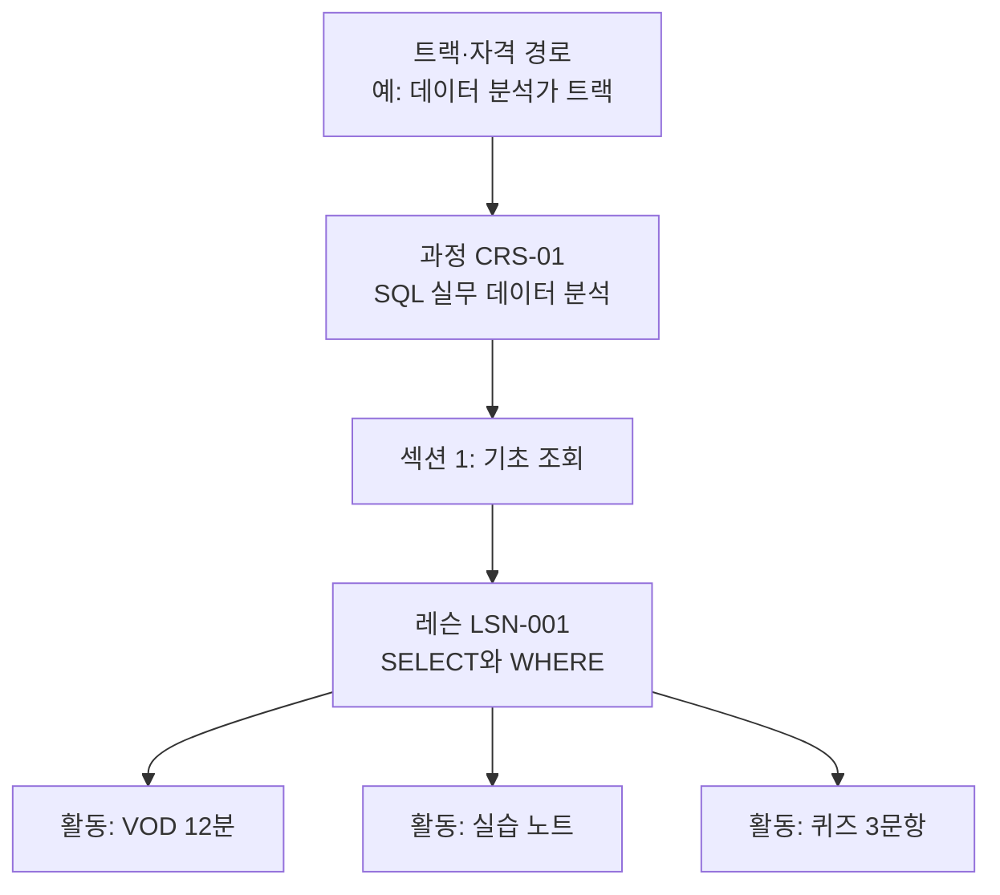

# L01 과정·콘텐츠구조설계서

> **작성 가이드**
> - **목적**: 판매·운영 단위인 과정(CRS)을 어떤 계층으로 쪼개고, 어떤 콘텐츠 유형과 메타데이터를 쓰며, 번들·트랙·자격 경로와 버전을 어떻게 관리할지 정합니다. L02~L06, P02, S06의 공통 기준입니다.
> - **입력**: E06 요구사항(REQ), E05 LO(있으면), `02.wiki/market/`의 경쟁 카탈로그, [[domain/학습콘텐츠구조]]
> - **경계**: E11은 "무엇을 어떻게 가르치고 평가하나"(문항·콘텐츠의 교육적 설계), L01은 "과정을 어떤 단위로 묶어 팔고 운영하나"입니다.
> - **게이트**: E06이 `done`이어야 합니다. 과정을 판매·운영하지 않으면 `status: n/a`와 사유를 적습니다.
> - **적용 유형**: AT01, AT02, AT03, AT04, AT08, AT09 필수 / AT07 과정 판매 시 / AT05, AT06 과정 운영 시 / AT10 해당 시
> - **검토 패널 (권장)**: 콘텐츠 기획 리드, 강사 대표 1명, 운영 매니저, 검색·추천 담당, B2B 영업
> - 표의 첫 행은 예시 서비스 **스킬업**(성인 대상 VOD + 라이브 강의 마켓플레이스, 강사 입점·수익배분, 기업 B2B 좌석 판매, 일부 사업주 환급 과정) 기준입니다.

---

## 1. 카탈로그 분류

| 수준 | 분류 기준 | 값 목록 위치 | 예시 |
|------|-----------|--------------|------|
| 대분류 | {직무군 / 주제} | `02.wiki/company/카탈로그분류.md` | 데이터·AI |
| 중분류 | {세부 직무·기술} | 동일 | 데이터 분석 |
| 수준 | {입문 / 실무 / 심화} | 동일 | 실무 |
| 대상 | {직급·경력·역할} | 동일 | 마케터 1~3년차 |
| 판매 채널 | {B2C / B2B 좌석 / 환급 과정} | 동일 | B2C + B2B |

분류 원칙: 한 과정은 대분류 1개, 중분류 최대 {N}개 [가정]. 태그는 검색용으로 따로 둡니다.

## 2. 과정 계층

| 층 | 정의 | 식별자 | 운영 규칙 | 예시 |
|----|------|--------|-----------|------|
| 트랙 | 여러 과정을 순서대로 묶은 경로 | TRK-{nn} | 선수 과정 지정 가능 | TRK-01 데이터 분석가 |
| 과정 | 판매·수강 신청·수료 단위 | CRS-01 | 가격·수강 기간·수료 기준(L03)이 붙는 단위 | CRS-01 SQL 실무 데이터 분석 |
| 섹션 | 레슨 묶음(주차·챕터) | CRS-01-S{n} | 순차 잠금 단위(L03) | S1 기초 조회 |
| 레슨 | 진도 계산의 최소 단위 | LSN-001 | 진도율 분모(L03 PG-01) | LSN-001 SELECT와 WHERE |
| 활동 | 레슨 안의 개별 콘텐츠 | LSN-001-A{n} | 유형별 완료 조건(L03) | A1 VOD 12분 |

규모 계획: {과정 수} × {평균 레슨 수} × {레슨당 분량}. 예시: 출시 시 40과정 × 24레슨 × 15분 ≈ 240시간 [가정].

## 3. 콘텐츠 유형

| 유형 | 설명 | 완료 판정 (L03 연결) | 제작 단위 (L02) | 표준 패키징 (L05) | 예시 |
|------|------|----------------------|-----------------|-------------------|------|
| VOD | 녹화 강의 | 시청 구간 비율 | 촬영·편집 | {SCORM / 자체} | LSN-001-A1 12분 |
| 라이브 | 실시간 강의·세미나 | 출석 시간 비율 | 라이브 운영 | {xAPI / 출석 CSV} | {} |
| 실습 | 코드·도구 실습 환경 | 제출 또는 자동 채점 통과 | 실습 설계 | {LTI 1.3 도구} | {} |
| 문서 | PDF·슬라이드·읽을거리 | 열람 또는 확인 클릭 | 원고 | {} | {} |
| 퀴즈 | 형성평가 | 제출 (통과 기준은 L04) | 문항 제작 | {QTI} | {} |
| {유형} | {} | {} | {} | {} | {} |

## 4. 메타데이터

> 과정·레슨 메타데이터의 필수 필드가 비면 판매 페이지에 노출하지 않습니다.

| 필드 | 대상 | 필수 | 형식 | 용도 | 예시 (CRS-01) |
|------|------|:---:|------|------|---------------|
| course_id | 과정 | 필수 | CRS-00 | 식별 | CRS-01 |
| 제목·부제 | 과정 | 필수 | 텍스트 | 판매·검색 | SQL 실무 데이터 분석 |
| 학습 목표 | 과정 | 필수 | LO-ID 또는 문장 3~5개 | 상세 페이지, L04 평가 연결 | LO-01 조인으로 지표 집계 |
| 총 학습 시간 | 과정 | 필수 | 분 (레슨 합계 자동 계산) | 환급 과정 요건, 진도 | 360분 |
| 수준·대상 | 과정 | 필수 | 1절 값 | 추천·필터 | 실무 / 마케터 |
| 강사 | 과정 | 필수 | instructor_id (복수 가능, 지분은 S07) | 정산, 프로필 | INS-012 |
| 수강 기간 | 과정 | 필수 | 일 | L03 수강 기간 | 90일 [가정] |
| 판매 채널 | 과정 | 필수 | B2C/B2B/환급 | 가격(S03), 진도 규칙 분기 | B2C, B2B |
| 언어·자막 | 레슨 | 필수 | ko / en … | 접근성(E13), 자막(L02) | ko 자막 |
| 레슨 길이 | 레슨 | 필수 | 초 | 진도 계산 | 720 |
| 버전 | 과정·레슨 | 필수 | v{major}.{minor} | 5절 | v1.2 |
| 권리 상태 | 과정 | 필수 | 독점/비독점, 계약 종료일 | P02 | 비독점, 2028-03-31 |
| {필드} | {} | {} | {} | {} | {} |

## 5. 번들·트랙·자격 경로

| 묶음 유형 | 구성 규칙 | 가격 연결 (S03·S06) | 수료 연결 (L03·L06) | 예시 |
|-----------|-----------|---------------------|---------------------|------|
| 번들 | 과정 N개 묶음 판매 | 묶음 할인 | 과정별 수료 | 데이터 입문 3종 번들 |
| 트랙 | 순서 있는 과정 묶음, 선수 과정 | 트랙 가격 또는 구독 | 트랙 수료 = 모든 과정 수료 | TRK-01 |
| 자격 경로 | 외부 자격·사내 직무 인증과 정렬 | {} | 디지털 배지(L06) | {} |
| 구독 | 카탈로그 전체 또는 일부 | 월·연 구독 | 과정별 수료 | {} |

## 6. 버전 관리

| 변경 유형 | 예 | 버전 | 기존 수강생 처리 | 수료·진도 영향 |
|-----------|----|------|------------------|----------------|
| 경미 수정 | 오탈자, 자막 수정 | minor +1 | 즉시 반영 | 없음 |
| 레슨 교체·추가 | 레슨 2개 재촬영 | minor +1 | 즉시 반영, 완료한 레슨은 완료 유지 | 분모 변경 시 L03 규칙 적용 |
| 구조 개편 | 섹션 재구성, 50% 이상 교체 | major +1 | 기존 수강생은 구버전 유지 또는 선택 전환 [가정] | 환급 과정은 심사 영향 [확인 필요] |
| 폐기 | 계약 종료, 내용 노후 | 판매 중지 | 수강 기간 종료까지 열람 보장 [가정] | P01·P02 연결 |

## 서비스 유형별 메모

| 유형 | 이 문서가 달라지는 점 |
|------|------------------------|
| AT02 기업교육 LMS | 카탈로그가 고객사별로 분리(테넌트별 노출 목록), 필수 교육·직무 역량 체계와 매핑, 사업주 환급 과정은 차시·시간 구성이 심사 요건에 묶임 [확인 필요] |
| AT03 부트캠프 | 과정 = 기수(cohort) 단위, 주차 섹션과 프로젝트 활동이 중심, 라이브·실습 비중이 크고 카탈로그는 작음 |
| AT05 K-12 코스웨어 | 과정 대신 교과 > 단원 > 차시 구조를 E11이 맡음. 판매 단위가 학교 라이선스면 번들·트랙·자격 경로는 `n/a` 가능 |

## 완료 체크리스트

- [ ] 카탈로그 분류 기준과 값 목록 위치가 정해졌다
- [ ] 트랙 > 과정 > 섹션 > 레슨 > 활동 계층과 ID 규칙(CRS-01, LSN-001)이 있다
- [ ] 콘텐츠 유형마다 완료 판정 방식이 L03과 연결된다
- [ ] 과정·레슨 메타데이터 필수 필드와 노출 차단 규칙이 있다
- [ ] 번들·트랙·자격 경로가 가격(S03·S06)과 수료(L03·L06)에 연결된다
- [ ] 버전 변경 시 기존 수강생 처리 규칙이 있다
- [ ] 강사·권리 메타데이터가 S07·P02로 전달된다
- [ ] 근거 없는 수치에 `[가정]`, 환급 과정 요건에 `[확인 필요]`가 붙어 있다
