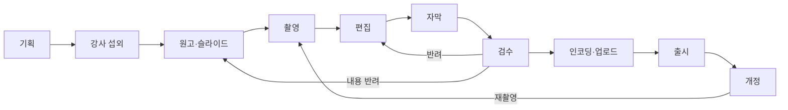

# L02 콘텐츠제작파이프라인

> **작성 가이드**
> - **목적**: 과정 하나가 기획부터 출시·개정까지 어떤 단계를 거치고, 단계마다 누가 무엇을 언제까지 얼마에 만드는지 정합니다. 외주·AI 보조 범위와 검수 기준도 여기서 정합니다.
> - **입력**: L01 과정 구조·콘텐츠 유형, P02 강사 계약 조건(있으면), `02.wiki/company/`의 외주 단가, [[domain/콘텐츠제작파이프라인]]
> - **게이트**: L01이 `done`이어야 합니다. 비용 수치는 표나 스크립트로 재현 가능해야 하며 근거 없는 값은 `[가정]`입니다. AI 자막·번역을 쓰면 A07, 품질 기준은 P04, 강사 운영은 P06과 연결합니다.
> - **적용 유형**: AT01, AT02, AT03, AT08, AT09 필수 / AT04, AT07 해당 시 / AT05, AT06은 E11 파이프라인으로 대체 가능
> - **검토 패널 (권장)**: 콘텐츠 PD, 강사 대표, 영상 편집 담당(외주 포함), QA, 재무
> - 표의 첫 행은 예시 서비스 **스킬업**(성인 대상 VOD + 라이브 강의 마켓플레이스, 강사 입점·수익배분, 기업 B2B 좌석 판매, 일부 사업주 환급 과정) 기준입니다.

---

## 1. 단계 흐름

## 2. 단계별 정의

| 단계 | 담당 | 입력 | 산출 | 통과 기준 | 표준 소요 | 예시 (CRS-01) |
|------|------|------|------|-----------|-----------|---------------|
| 기획 | {콘텐츠 PD} | 시장 수요, L01 분류 | 과정 기획서(목표·목차·대상·가격대) | 기획 심의 통과 | {일} | 10일 [가정] |
| 강사 섭외 | {PD·강사 운영} | 기획서 | 계약(P02), 강사 프로필 | 계약 서명, 수익배분율 확정(S07) | {일} | 14일 [가정] |
| 원고·슬라이드 | {강사} | 목차 | 레슨별 원고, 슬라이드, 실습 자료 | PD 내용 검토, 저작권 점검 | {일} | 20일 [가정] |
| 촬영 | {스튜디오/강사 자가 촬영} | 원고 | 원본 영상 | 음질·화질 기준(P04) | {일} | 3일 |
| 편집 | {편집자/외주} | 원본 | 편집본 (레슨 단위) | 컷·자막 위치·화면 텍스트 | {일} | 10일 |
| 자막 | {AI 초안 + 사람 검수} | 편집본 | 자막 파일 (SRT·VTT) | 오류율 기준 이하 | {일} | 3일 |
| 검수 | {QA·PD} | 편집본+자막 | 검수 리포트 | P04 출시 전 기준 전 항목 통과 | {일} | 3일 |
| 인코딩·업로드 | {운영} | 최종본 | 스트리밍 파일, DRM, 메타데이터(L01 4절) | 재생 테스트, 메타 완비 | {일} | 1일 |
| 출시 | {운영·마케팅} | 판매 페이지 | 공개 | 가격(S03)·환불(P01) 연결 확인 | {일} | 1일 |
| 개정 | {PD} | 오류 신고·리뷰·노후화 | 개정 계획 | L01 6절 버전 규칙 | 정기 {주기} | 연 1회 점검 [가정] |

## 3. 일정 계획

| 과정 | 시작 | 원고 완료 | 촬영 | 편집 완료 | 출시 목표 | 시즌 (G-CAL) | 상태 |
|------|------|-----------|------|-----------|-----------|--------------|------|
| {CRS-ID} | {} | {} | {} | {} | {} | {} | {} |
| 예시: CRS-01 | 2027-01-04 | 2027-02-05 | 2027-02-15 | 2027-03-02 | 2027-03-15 | 신년·연초 HRD 예산 집행기 [가정] | 계획 |

과정 하나의 표준 리드타임은 2절 합계로 계산합니다(예시 합계 65일 [가정]). 병렬 제작 가능 수는 편집 인력에 묶입니다.

## 4. 비용 구조

| 항목 | 공식 | 변수 출처 | 예시 (CRS-01, 24레슨 × 15분) |
|------|------|-----------|------------------------------|
| 강사 제작료 | {선지급 / 없음, 수익배분만} | P02, S07 | 없음 (수익배분형) [가정] |
| 스튜디오 | 촬영일 × 일 대관료 | 스튜디오 견적 | 3일 × {금액} |
| 편집 | 완성 분량(분) × 분당 단가 | 외주 단가표 | 360분 × {분당 단가} |
| 자막 | 분량 × (AI 처리 단가 + 검수 단가) | A07, 외주 단가 | {} |
| 인코딩·DRM·저장 | 분량 × 단가 + 월 저장비 | B04, CDN 청구서 | {} |
| 과정당 총 제작비 | 위 합계 | 스크립트 | {금액} — S06 CAC·회수 기간 입력 |

금액 계산은 `automation/scripts/L02_제작비.py` {경로}로 하고, 실제 단가는 `02.wiki/company/`에만 둡니다.

## 5. 외주·AI 보조 범위

| 작업 | 내부 / 외주 / AI 보조 | 사람 검수 | 권리·보안 조건 | 예시 |
|------|------------------------|-----------|----------------|------|
| 편집 | {} | PD 최종 확인 | 원본 외부 반출 시 NDA, 워터마크 원본 | 외주 |
| 자막 생성 | {} | 필수 (전문 용어·고유명사) | 음성 데이터 AI 업체 전송 동의(P02·E13) | AI 초안 + 검수 |
| 번역 자막 | {} | 필수 | 2차 이용 권리(P02) | {} |
| 퀴즈 초안 | {} | 강사 승인 필수 | A08 | {} |
| 썸네일·요약 문구 | {} | 마케팅 승인 | 과장 표현 금지 | {} |

## 6. 품질 게이트 (검수 단계)

| 항목 | 기준 | 판정 | 근거 |
|------|------|------|------|
| 내용 정확성 | 강사·PD 검토, 오류 0 | {통과/보완} | P04 |
| 음질·화질 | {해상도, 음량 기준} | {} | P04 |
| 자막 정확도 | {오류율 목표} [가정] | {} | A07, E13 접근성 |
| 저작권 | 제3자 자료 출처·허락 | {} | P02 |
| 메타데이터 | L01 4절 필수 필드 완비 | {} | L01 |
| 환급 과정 요건 | 시간·차시·평가 구성 [확인 필요] | {해당 시} | L03 |

## 서비스 유형별 메모

| 유형 | 이 문서가 달라지는 점 |
|------|------------------------|
| AT02 기업교육 LMS | 고객사 맞춤 과정은 고객 검수 단계가 추가되고 SCORM 패키징(L05)이 납품물. 환급 과정은 심사 신청 일정이 출시 일정을 결정 [확인 필요] |
| AT03 부트캠프 | VOD보다 커리큘럼·실습 과제·프로젝트 브리프 제작이 중심, 기수마다 개정 주기가 짧음 |
| AT05 K-12 코스웨어 | 영상보다 문항·차시 콘텐츠 제작이 중심이라 E11 5절 파이프라인을 쓰고 이 문서는 `n/a` 또는 영상 보조 자료만 다룸 |

## 완료 체크리스트

- [ ] 기획부터 개정까지 단계별 담당·산출·통과 기준·표준 소요가 있다
- [ ] 과정별 일정이 시즌(G-CAL)과 충돌 검토되었다
- [ ] 비용 항목마다 공식과 변수 출처가 있고 계산 스크립트 경로가 있다
- [ ] 외주·AI 보조 작업마다 사람 검수와 권리·보안 조건이 있다
- [ ] 검수 단계 품질 게이트가 P04와 일치한다
- [ ] 실제 단가가 이 문서가 아니라 `02.wiki/company/`에 있다
- [ ] 과정당 제작비가 S06 단위 경제성 입력으로 전달되었다
