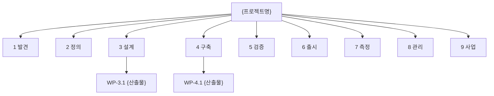
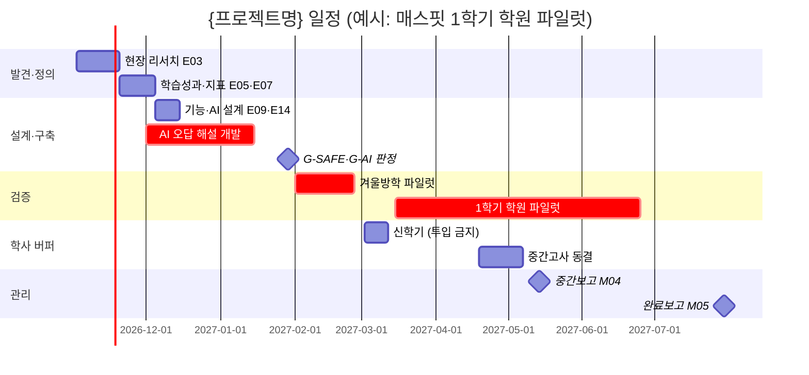

# M02 WBS·일정계획

> **작성 가이드**
> - **목적**: M01의 범위와 산출물 목록을 작업 패키지(WP)로 쪼개고, 담당·공수·선후관계·학사일정 제약을 붙여 일정 기준선을 만듭니다. 원본 데이터는 `M02_WBS.csv`이며, 이 문서는 그 요약·해설입니다. 둘이 다르면 CSV가 기준입니다.
> - **입력**: M01(범위, 산출물 목록, 마일스톤), E15 릴리즈계획서(있으면 MS·FZ), [[domain/학사일정]], 회사 학사 캘린더(E00 6절), 팀 가용 인원
> - **게이트**: M01이 `done`이어야 합니다. **실체 검증**: `M02_WBS.csv`가 있고, 학사일정 이벤트(시험·방학·신학기)가 `학사제약` 열과 5절 마일스톤에 반영되어야 합니다. 공수·일정 추정치는 근거가 없으면 `[가정]`입니다.
> - **검토 패널 제안**: 개발 리드, 콘텐츠 리드, 영업 리드(현장 일정), 스폰서 — 초안 생성·CSV 갱신은 `/edpm-wbs`, 진척 반영은 `/edpm-brief weekly`.
> - 예시는 "매스핏 2027학년도 1학기 학원 파일럿 프로젝트" 기준입니다. 예시 행은 실제 작성 시 지웁니다.

## 1. WBS 구조

WP 번호는 `WP-{단계}.{순번}`입니다. 단계 번호: 1 발견, 2 정의, 3 설계, 4 구축, 5 검증, 6 출시, 7 측정, 8 관리(M), 9 사업(S). B·A 트랙 작업은 해당 단계(설계·구축) 아래에 둡니다.

## 2. 작업 패키지 목록

`M02_WBS.csv`와 같은 열을 씁니다. 산출물 ID가 없는 작업(파일럿 운영 등)은 관련 문서 ID를 적고, 여러 개면 `;`로 구분합니다. CSV의 `(예시)` 행 6개는 모두 공수·날짜가 [가정]이며 실제 작성 시 지웁니다.

| wp_id | 이름 | 단계 | 산출물ID | 담당 | 공수(일) | 시작 | 종료 | 선행 | 학사제약 | 상태 | 이슈 |
|-------|------|------|---------|------|---------|------|------|------|---------|------|------|
| {WP-1.1} | {} | {발견} | {E03} | {} | {} | {} | {} | {} | {없음 / 시험기간 인터뷰 불가 등} | {예정/진행/완료/지연} | {push 후 자동: GitHub 이슈 번호} |
| 예시 WP-4.2 | AI 오답 해설 (F-012) 개발 | 구축 | E15 | 개발 리드 | 30 [가정] | 2026-12-01 | 2027-01-15 | WP-3.3 | 겨울방학 파일럿(2/1) 전 완료 필수 | 예정 | 42 |

## 3. 간트 차트

## 4. 주경로 (Critical Path)

| 순서 | WP | 여유(일) | 지연 시 영향 |
|------|----|---------|-------------|
| {1} | {WP-x.x} | {0} | {} |
| 예시 1 | WP-4.2 AI 오답 해설 개발 → G-AI 판정 → WP-5.1 겨울방학 파일럿 | 0 | 겨울방학을 놓치면 파일럿이 신학기와 겹쳐 1학기 확대가 중간고사 이후로 밀림 |

## 5. 마일스톤과 게이트 점검

| MS-ID | 마일스톤 | 목표일 | 게이트 점검 | 학사 이벤트 반영 | 상태 |
|-------|---------|--------|------------|-----------------|------|
| {MS-01} | {} | {} | {G-LEARN / G-SAFE / G-AI / G-EVIDENCE / G-CAL / 해당 없음} | {} | {} |
| 예시 MS-03 | 1학기 학원 파일럿 시작 | 2027-03-15 | G-SAFE(E13 done, 출시 차단 0건), G-AI(E14 done), G-CAL | 신학기 1~2주 이후로 배치 | 예정 |

E15에 같은 마일스톤이 있으면 MS-ID를 그대로 씁니다.

## 6. 학사일정 버퍼

| 학사 이벤트 | 기간 | 버퍼 규칙 | 영향 WP |
|------------|------|----------|---------|
| 신학기 | {3월 1~2주} | 신규 투입·교사 연수 금지 | {} |
| 중간·기말고사 | {[확인 필요]} | 배포 동결, 현장 설문·인터뷰 금지, 앞뒤 1주 버퍼 | {} |
| 여름·겨울방학 | {} | 학교 연락 지연 감안, 학원은 특강 기간 활용 | {} |
| 교육청 예산·조달 마감 | {[확인 필요]} | 계약 서류 2주 버퍼 | {} |
| 예시: 중간고사 | 2027-04-19 ~ 05-07 [확인 필요] | 동결(FZ-01), 학원 원장 미팅 금지 | WP-5.2, WP-8.3 |

## 7. 자원 부하

주 단위 투입 인원(명) 또는 공수(일)입니다. 한 사람이 같은 주 100%를 넘으면 표시합니다.

| 담당 | {YYYY-MM 1주} | {2주} | {3주} | {4주} | 과부하 |
|------|-----|-----|-----|-----|------|
| {개발} | {} | {} | {} | {} | {} |
| {콘텐츠} | {} | {} | {} | {} | {} |
| 예시: 콘텐츠 (3명) | 3 | 3 | 4 | 4 | 3·4주 초과 → 교사 자문단 검수 1명 추가 [가정] |

## 8. 변경 통제

기준선(M01 승인 시점의 범위·일정·예산)을 바꾸는 변경은 M03 6절 변경요청(CR) 로그에 남깁니다.

| 변경 규모 | 기준 | 승인자 |
|----------|------|--------|
| 경미 | 주경로 밖, 여유 내 일정 이동 | PM |
| 중간 | 주경로 지연 1주 이내, 범위 내 우선순위 조정 | PM + 개발 리드 |
| 중대 | 마일스톤·학사 투입일 변경, 범위·예산 변경 | 스폰서 (고객사·교육청 과제는 고객 측 담당 합의) |

변경 승인 후 `/edpm-wbs`로 CSV와 간트를 갱신하고, 주간보고 3절에 기록합니다.

## 9. 일정 관리 도구 연동

일정 관리 도구는 `AGENTS.md` 2절 "일정 관리 도구"와 `automation/wbs.json`에 정합니다. 기본은 **GitHub**(Issues·Milestones·Projects)이며 회사 사정에 따라 스프레드시트·Notion·Jira·Linear로 바꿀 수 있습니다. 상세: 프레임워크 `guide/12.일정관리도구연동.md`.

| 필드 | 정본 | 바꾸는 곳 |
|------|------|-----------|
| 계획: 이름, 단계, 산출물ID, 공수, 시작, 종료, 선행, 학사제약 | `M02_WBS.csv` | CSV를 고친 뒤 `/edpm-wbs push` |
| 진행: 상태 | 일정 관리 도구 | 도구에서 바꾸고 `/edpm-wbs pull`로 CSV에 반영 |
| 연결: 이슈 | 도구가 정한 번호·키 | `push`가 자동 기록 |

| 도구 | 반영 방식 | 상태 가져오기 |
|------|-----------|---------------|
| GitHub (기본) | WP = 이슈, 단계 = 마일스톤(기한 = 단계 마지막 종료일), 라벨 `wp`·`단계:`·`산출물:`, Projects를 쓰면 `시작`·`종료` 날짜 필드로 로드맵 | 이슈 닫힘 = 완료, 라벨 `상태:진행`·`상태:지연` |
| 스프레드시트 (Excel·Google Sheets) | `export --to sheets` CSV 가져오기, Google Sheets 연결 시 시트에 직접 기록 | 상태 열을 CSV로 내보내 `상태` 열에 반영 |
| Notion | `export --to notion` CSV로 데이터베이스 가져오기, 타임라인 보기는 `시작`·`종료`를 날짜 속성으로 | 데이터베이스를 CSV로 내보내 반영 |
| Jira·Linear | `export --to jira`·`--to linear` CSV 가져오기 (가져오기 화면에서 열 매핑 확인) | 이슈 목록을 CSV로 내보내 반영 |

`/edpm-brief weekly`와 `/edpm-brief report`는 진척을 이 CSV(`wbs_sync.py status`)에서 읽습니다. 도구에서 바뀐 상태는 그 전에 `pull`로 가져옵니다.

## 교육과정 지식그래프 연결

> 국가 교육과정(2022 개정) 기반 제품일 때 작성합니다. 도구: `/edpm-curriculum`, `automation/kg/kg_query.py`. KG는 공식 자료가 아니며, 공식 관계와 권장 순서(후보)를 구분해 씁니다. KG 릴리스: {`kg_query.py stats` 결과}

- 콘텐츠 제작량 추정: 범위 성취기준 수(`kg_query.py coverage`의 전체 수) × 성취기준당 문항·콘텐츠 수 = 집필·감수 WP 공수의 근거.
- KG 갱신 확인(`kg_sync.sh --check`)을 분기 1회 WP로 둡니다.

## 완료 체크리스트

- [ ] M01이 `done`이고, M01 산출물 목록의 활성 산출물이 모두 WP에 매핑되었다
- [ ] `M02_WBS.csv`가 있고 문서 2절과 내용이 같다 (실체 검증)
- [ ] 모든 WP에 담당·공수·시작·종료·선행이 있다
- [ ] 학사 이벤트가 `학사제약` 열과 5절 마일스톤에 반영되었다 (G-CAL)
- [ ] 주경로가 식별되고 지연 영향이 적혀 있다
- [ ] 게이트(G-SAFE, G-AI, G-EVIDENCE)가 해당 마일스톤 전에 배치되었다
- [ ] 시험·방학 버퍼가 일정에 들어갔다
- [ ] 자원 과부하 주간과 대응이 정리되었다
- [ ] 근거 없는 공수·날짜에 `[가정]`, 미확인 학사 날짜에 `[확인 필요]`가 있다
- [ ] 변경 통제 규칙과 승인자가 합의되었다
- [ ] 일정 관리 도구가 정해졌고 WP가 반영되었다 (기본 GitHub: `/edpm-wbs push`)
- [ ] (교육과정 기반이면) 콘텐츠 제작 WP 공수가 성취기준 수에 근거한다
