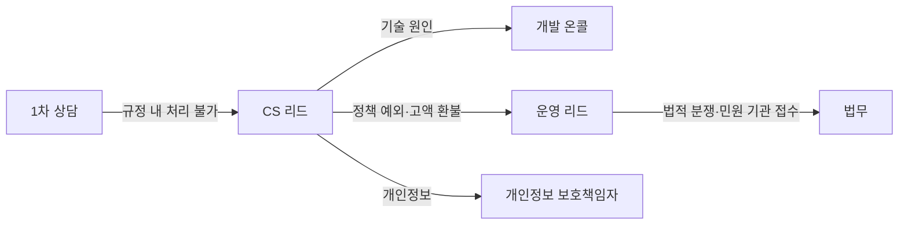

# P05 고객지원·운영정책

> **작성 가이드**
> - **목적**: CS 채널, 우선순위별 응답 기준(SLA), 문의 분류 체계, 에스컬레이션, 장애·공지 템플릿, VOC를 위키로 되돌리는 흐름, CS 지표를 정합니다. P01 환불, P03 이의 제기, P04 오류 신고가 모두 이 문서의 접수 경로를 씁니다.
> - **입력**: E02(이해관계자: 학습자·보호자·기관 담당자), E06(지원 범위), P01·P03·P04(처리 규칙), E13(개인정보 요청 처리), B04(장애 대응 체계), `02.wiki/research/` VOC 인사이트
> - **게이트**: 기본 게이트(E06 `done`). G-POLICY 직접 대상은 아니지만 E18 출시 전 CS 채널·SLA·공지 템플릿이 준비되어야 합니다. CS 지표는 헬프데스크 내보내기·SQL로 계산합니다.
> - **적용 유형**: 전 유형. 기관 고객(AT02·AT05·AT08)은 계약 SLA가 이 문서보다 우선합니다.
> - **검토 패널 (권장)**: CS 리드, 운영 리드, 개인정보 보호책임자, 법무(민원·분쟁 대응), 개발 온콜 담당
> - **스킬**: `/edpm-doc policy P05`
> - **주의**: 개인정보 열람·삭제 요청 처리 기한, 소비자 분쟁 대응 의무는 `[확인 필요]`로 두고 법무 검토를 받습니다. 이 문서는 법률 자문이 아닙니다. VOC 원문은 비식별화 후에만 `01.자료실/`에 넣습니다 (AGENTS.md 7절).
> - 표의 예시 행은 샘플 서비스 **스킬업**(성인 대상 VOD + 라이브 강의 마켓플레이스, 강사 입점·수익배분, 기업 B2B 좌석, 일부 사업주 환급 과정) 기준입니다.

---

## 1. 지원 채널

| 채널 | 대상 | 운영 시간 | 담당 | 비고 |
|------|------|----------|------|------|
| {FAQ·도움말 센터} | 전체 | 24시간 | {} | 자가 해결 우선 |
| {1:1 문의(웹·앱)} | 전체 | {} | {} | 문의 분류 필수 선택 |
| {채팅 (사람·AI 챗봇)} | {} | {} | {} | AI 응답은 E14·A03 기준, 환불 확정 안내 금지 |
| {전화} | {} | {} | {} | |
| {기관 전담 채널} | B2B 담당자 | {} | {고객 성공 매니저} | 계약 SLA |
| 예시: 1:1 문의 | 스킬업 수강생 | 평일 10~18시 | CS팀 | 라이브 강의 중에는 채팅 우선 [가정] |

## 2. 우선순위와 SLA

| 우선순위 | 기준 | 첫 응답 | 해결 목표 | 예 |
|----------|------|---------|----------|----|
| P1 긴급 | 서비스 전체·다수 장애, 결제 오류 대량, 개인정보 유출 의심 | {n}분 | {n}시간 | 라이브 강의 송출 중단 |
| P2 높음 | 개인 학습 불가, 시험·수료 마감 임박 | {n}시간 | {n}영업일 | 시험 제출 오류 |
| P3 보통 | 일반 문의, 환불 요청 | {n}영업일 | {n}영업일 | 환불 문의 |
| P4 낮음 | 제안·의견 | {n}영업일 | 백로그 | 기능 제안 |
| 예시: P2 | 환급 과정 수료 마감 D-1 진도 미반영 | 1시간 [가정] | 당일 [가정] | 스킬업 환급 과정 수강생 |

### 2.1 정책 조항 (POL, 이용약관·운영 매뉴얼 반영)

| POL-ID | 조항 | 반영 위치 |
|--------|------|-----------|
| POL-01 (예시) | 1:1 문의는 접수 후 {n}영업일 내 첫 응답하며, 장애로 인한 학습 손실은 수강기간 연장으로 보상한다 | 이용약관 제{n}조, CS 매뉴얼 |
| {POL-0N} | {조항} | {위치} |

## 3. 문의 분류 체계

| 대분류 | 소분류 예 | 처리 기준 문서 | 기본 우선순위 | 에스컬레이션 |
|--------|----------|---------------|--------------|-------------|
| 결제·환불 | 결제 실패, 이중 결제, 환불 요청, 영수증 | P01 | P3 | 재무 |
| 수강 오류 | 재생 불가, 진도 미반영, 기기 제한 | L03, P03 | P2 | 개발 온콜 |
| 수료증 | 미발급, 정보 오류, 진위 확인 | L06 | P3 | 운영 |
| 계정 | 로그인, 정지 이의 제기, 탈퇴 | P03 | P3 | 운영 리드 |
| 콘텐츠 오류 | 내용 오류, 자막, 실습 파일 | P04 | P3 (S1이면 P2) | 콘텐츠 운영·강사 |
| 개인정보 | 열람·정정·삭제·동의 철회 요청 [확인 필요: 처리 기한] | E13 | P2 | 개인정보 보호책임자 |
| 학부모·기관 민원 | 학습 내용·안전 우려, 계약 이행 | E13, 계약서 | P2 | 운영 리드 + 법무 |
| 예시: 수강 오류 | 스킬업 앱 오프라인 저장 후 진도 미반영 | L03 PG-02 | P2 | 개발 온콜 |

## 4. 에스컬레이션

| 상황 | 에스컬레이션 대상 | 기한 |
|------|------------------|------|
| 정책 예외 요청 (환불 기준 초과) | 운영 리드 | {n}영업일 |
| 외부 분쟁 조정 기관 접수 | 법무 | 즉시 |
| 예시: 강사 노쇼로 라이브 취소 | 운영 리드 → P06 제재 검토 | 당일 |

## 5. 장애·공지 템플릿

**장애 최초 공지**
> [{서비스명}] {영향 기능} 이용 장애 안내 — {발생 시각}부터 {증상}이 발생하고 있습니다. 원인을 확인 중이며 {다음 안내 시각}까지 다시 알려드리겠습니다. 진행 중인 시험·라이브 강의는 {보상 원칙}에 따라 처리합니다.

**장애 복구 공지**
> {복구 시각}에 복구되었습니다. 원인: {원인 요약}. 영향: {영향 범위}. 조치: {진도 보정·수강기간 연장·재응시}. 재발 방지: {조치}.

**정책 변경 공지**
> {변경 항목}이 {시행일}부터 변경됩니다. 변경 전: {}. 변경 후: {}. 기존 구매자 적용 여부: {}. (약관 변경 사전 고지 기간 [확인 필요])

| 장애 등급 | 공지 채널 | 보상 원칙 |
|----------|----------|----------|
| {P1} | {배너·이메일·앱 푸시} | {장애 시간만큼 수강기간 연장} |
| 예시: P1 라이브 송출 중단 30분 이상 | 앱 푸시 + 이메일 | 다시보기 제공 + 보강 회차 [가정] |

## 6. VOC → 위키 반영 루프

| 단계 | 내용 | 주기 | 산출 |
|------|------|------|------|
| 1 집계 | 문의 분류별 건수·추세 (헬프데스크 내보내기) | 주 | `05.outputs/P05_VOC집계_YYYYMMDD.csv` |
| 2 비식별화·저장 | 대표 문의 원문을 가명 처리 후 저장 | 월 | `01.자료실/현장/` |
| 3 인제스트 | `/edpm-wiki ingest`로 인사이트(IN-ID) 작성 | 월 | `02.wiki/research/` |
| 4 반영 | 인사이트 → E20 다음 사이클 후보, P01·P04 정책 개정 | 분기 | NC-ID, 정책 개정 이력 |
| 예시 | 스킬업 "기기 제한" 문의 월 120건 [가정] | 월 | IN-0NN → P03 기기 수 정책 재검토 |

## 7. CS 지표

| 지표 | 정의 | 목표 | 계산 경로 |
|------|------|------|-----------|
| 첫 응답 시간 | 접수 → 첫 응답 중앙값 (우선순위별) | {} | `automation/sql/{}.sql` |
| 해결 시간 | 접수 → 종료 중앙값 | {} | |
| SLA 준수율 | SLA 내 해결 ÷ 전체 | {} | |
| 재문의율 | 종료 후 {n}일 내 같은 분류 재문의 | {} | |
| 고객 만족도 | 종료 후 설문 평균 | {} | |
| 자가 해결률 | FAQ 조회 후 문의 미접수 비율 | {} | |
| 학습자 1천 명당 문의 수 | 월 문의 ÷ 활성 학습자 × 1,000 | {} | |
| 예시: SLA 준수율 | 스킬업 P2 문의 | 90% 이상 [가정] | `automation/sql/cs_sla.sql` |

## 8. 서비스 유형별 메모

| 유형 | 차이점 |
|------|--------|
| AT01 이러닝 마켓플레이스 | 강사 문의 채널(정산·업로드)을 수강생 채널과 분리, 강의 질문은 강사 Q&A로 라우팅 |
| AT02 기업교육 LMS | 기관 담당자 전담 창구, 계약 SLA, 환급 과정 진도·수료 문의 마감 집중 |
| AT04 라이브·튜터링 | 수업 시간 중 실시간 지원, 튜터 노쇼·지각 신고 경로, 미성년 수강 시 보호자 연락 |
| AT05 K-12·AT06 학원 | 교사·원장·학부모·학생 채널 분리, 학부모 민원은 학교·학원 경유 여부 결정, 학기초 문의 폭증 대비 (G-CAL) |
| AT07 구독 앱 | 앱스토어 결제 문의 안내, 구독 해지 경로 접근성, 셀프서비스 중심 |

---

## 완료 체크리스트

- [ ] 채널마다 운영 시간과 담당이 있다
- [ ] 우선순위별 SLA가 정해지고 기관 계약 SLA와 충돌하지 않는다
- [ ] 문의 분류마다 처리 기준 문서(P01·P03·P04·E13 등)가 연결되었다
- [ ] 개인정보 요청 처리 기한 `[확인 필요]`가 법무·개인정보 보호책임자 검토를 거쳤다
- [ ] 장애·공지 템플릿과 보상 원칙이 있다
- [ ] VOC 루프가 비식별화 → 자료실 → 위키 순서를 지킨다
- [ ] CS 지표마다 계산 경로가 있다
