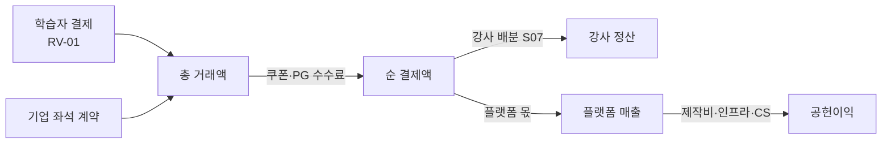

# S06 수익모델설계서

> **작성 가이드**
> - **목적**: 누가(E02 결제자) 무엇에 돈을 내는지 수익원(RV)을 정의하고, 수익원별 단위 경제성(LTV·CAC·회수 기간·코호트 유지율)과 시나리오를 계산합니다. S03 가격, S07 정산, E07 사업 지표(M-4x)의 기준이 됩니다.
> - **입력**: E02 이해관계자(사용자·구매자·결제자 구분), E06 범위, S03 가격·원가, L02 과정당 제작비, `02.wiki/market/`(경쟁 가격, verified 180일 이내), [[domain/에듀테크수익모델]], [[domain/과정가격전략]]
> - **게이트**: E02, E06이 `done`이어야 합니다. 모든 수치는 6절 스크립트나 SQL로 재현 가능해야 하며, LLM이 추정한 수치는 쓸 수 없습니다. 근거 없는 입력값은 `[가정]`, 실제 매출·단가는 `02.wiki/company/`에만 둡니다. 강사 수익배분이 있으면 S07, 유료 판매면 P01이 이어서 필요합니다(G-POLICY).
> - **적용 유형**: AT01, AT02, AT07 핵심 / AT03, AT04, AT06, AT08, AT09, AT10 유료 판매 시 / AT05는 라이선스·조달 구조만
> - **검토 패널 (권장)**: 사업 리더, 재무, 마케팅 리드, B2B 영업 리드, 데이터 분석가
> - 표의 첫 행은 예시 서비스 **스킬업**(성인 대상 VOD + 라이브 강의 마켓플레이스, 강사 입점·수익배분, 기업 B2B 좌석 판매, 일부 사업주 환급 과정) 기준이며 **모든 금액·비율은 형식을 보여주는 [가정] 값**입니다.

---

## 1. 수익원 (RV)

| RV-ID | 수익원 | 결제자 (E02 SH) | 과금 단위 | 매출 인식 | 강사 배분 (S07) | 가격 기준 (S03 PR-P) | 예시 |
|-------|--------|-----------------|-----------|-----------|-----------------|----------------------|------|
| RV-01 | {수익원} | {SH-ID} | {} | {일시 / 기간 안분} | {예/아니오} | {PR-P} | 스킬업 B2C 과정 단건 판매, 개인 학습자(SH-01), 과정당, 결제 시 [확인 필요: 회계 기준], 배분 있음, PR-P01 |
| RV-{nn} | {} | {} | {} | {} | {} | {} | {} |

서비스 유형별 대표 수익원 (참고):

| 유형 | 대표 수익원 | 주의할 점 |
|------|-------------|-----------|
| AT01 이러닝 마켓플레이스 | 과정 단건, 번들, 구독, 강사 입점 수수료 | 강사 배분 후 플랫폼 몫이 실제 매출, 쿠폰 부담 주체 |
| AT02 기업교육 LMS | 좌석(연), 플랫폼 이용료, 맞춤 제작비, 환급 과정 | 환급 과정은 기준 변경 위험 [확인 필요], 갱신률이 LTV 결정 |
| AT03 부트캠프 | 기수 수강료, 정부 지원 과정, 취업 연계 수수료 | 소득공유형 계약은 법무 검토 [확인 필요] |
| AT05 K-12 코스웨어 | 학교·교육청 라이선스 | 조달·예산 주기, 학부모 결제와 분리 |
| AT07 소비자 학습앱 | 월·연 구독, 인앱 결제 | 앱스토어 수수료, 해지율 |

## 2. 수익 구조 흐름



총 거래액과 플랫폼 매출을 구분해 보고합니다. 마켓플레이스는 총 거래액만 보면 사업 규모를 과대평가합니다.

## 3. 단위 경제성

| 지표 | 정의 (계산식) | 데이터 출처 | 계산 위치 | E07 지표 |
|------|---------------|-------------|-----------|----------|
| 공헌이익/주문 | 평균 주문 금액 × 공헌이익률 | 결제 DB, S07, S03 원가 | 6절 | M-4{n} |
| LTV | 공헌이익/주문 × 연간 주문 횟수 × 평균 고객 수명(년) (B2B: 연 공헌이익 ÷ (1 − 갱신률)) | 결제 DB, 코호트 | 6절 | M-4{n} |
| CAC | 기간 마케팅·영업비 ÷ 신규 결제 고객 수 | 광고 청구서, CRM | `automation/sql/S06_cac.sql` {경로} | M-4{n} |
| LTV/CAC | LTV ÷ CAC | 위 | 6절 | M-4{n} |
| 회수 기간 | CAC ÷ 월 공헌이익 | 위 | 6절 | M-4{n} |
| 코호트 유지율 | 첫 결제 월 코호트 중 n개월 차에 다시 결제(또는 활성)한 비율 | 결제·학습 이벤트(E12) | `automation/sql/S06_cohort.sql` {경로} | M-4{n} |

| 세그먼트 | 공헌이익/단위 | LTV | CAC | LTV/CAC | 회수 기간 | 목표 | 판정 |
|----------|---------------|-----|-----|---------|-----------|------|:---:|
| {세그먼트} | {} | {} | {} | {} | {} | {} | {적합/주의} |
| 예시: B2C 단건 | 24,000원/주문 | 72,000원 | 30,000원 | 2.4 | 10개월 | LTV/CAC 3 이상 [가정] | 주의 |

코호트 유지율 표 (월 단위):

| 첫 결제 월 | 코호트 크기 | M1 | M3 | M6 | M12 | 계산 경로 |
|------------|-------------|----|----|----|-----|-----------|
| {YYYY-MM} | {n} | {} | {} | {} | {} | {SQL} |
| 예시: 2027-03 | {n} | 40% | 25% | 18% | {} | S06_cohort.sql [가정 값] |

## 4. 가격 연결 (S03)

| 항목 | S06에서 정하는 것 | S03에서 정하는 것 |
|------|-------------------|-------------------|
| 가격 수준 | 목표 LTV/CAC와 공헌이익률에서 역산한 하한 | 정가표, 할인, 견적 양식 |
| 할인 | 할인이 LTV·회수 기간에 주는 영향 | 할인율·승인자·하한 |
| 쿠폰 | 쿠폰 부담 주체(플랫폼/강사)가 공헌이익에 주는 영향 | 쿠폰 발행 조건 |
| 예시 | 플랫폼 부담 쿠폰 10%면 공헌이익/주문 감소분을 6절에서 재계산 | PR-P01 정가 |

## 5. 시나리오

| 변수 | 보수 | 기준 | 낙관 | 근거 |
|------|------|------|------|------|
| 평균 주문 금액 | {} | {} | {} | {} |
| 공헌이익률 | {} | {} | {} | S07 배분율, S03 원가 |
| 연간 주문 횟수 | {} | {} | {} | 코호트 |
| CAC | {} | {} | {} | 광고 채널 실적 |
| B2B 갱신률 | {} | {} | {} | 고객 계약 이력 |
| 예시: 기준 | | AOV 80,000 / 30% / 1.5회 / 30,000 / 80% [가정] | | |

시나리오 결과(LTV/CAC, 회수 기간, 손익분기 고객 수)는 6절 스크립트를 변수만 바꿔 실행해 채웁니다.

## 6. 계산 스크립트 (재현 가능)

경로: `automation/scripts/S06_단위경제성.py` (사람 승인 후 저장). 출력은 `05.outputs/S06_단위경제성_YYYYMMDD_HHMM.csv`.

```python
# 스킬업 예시 변수 — 모두 [가정]
aov, cm_rate, orders_per_year, life_years, cac = 80_000, 0.30, 1.5, 2, 30_000
cm_order = aov * cm_rate
ltv = cm_order * orders_per_year * life_years
payback = cac / (cm_order * orders_per_year / 12)
print(f"B2C cm={cm_order:,.0f} LTV={ltv:,.0f} LTV/CAC={ltv/cac:.1f} payback={payback:.0f}개월")

seat_price, seats, b2b_cm, renewal, b2b_cac = 120_000, 100, 0.60, 0.80, 6_000_000
yearly_cm = seat_price * seats * b2b_cm
b2b_ltv = yearly_cm / (1 - renewal)
print(f"B2B yearly_cm={yearly_cm:,.0f} LTV={b2b_ltv:,.0f} "
      f"LTV/CAC={b2b_ltv/b2b_cac:.1f} payback={b2b_cac/(yearly_cm/12):.0f}개월")
# 기대 출력: B2C cm=24,000 LTV=72,000 LTV/CAC=2.4 payback=10개월
#           B2B yearly_cm=7,200,000 LTV=36,000,000 LTV/CAC=6.0 payback=10개월
```

## 7. 지표 연결 (E07 M-4x)

| M-ID | 지표 | 정의 | 출처 절 | 갱신 |
|------|------|------|---------|------|
| M-4{n} | {지표} | {} | {} | {} |
| 예시: M-41 | B2C LTV/CAC | 3절 정의 | 3절, 6절 | 월 1회 |

사업 지표는 E07에서 보조 지표입니다. 학습 효과 북극성(M-01)과 함께 보고하고, 매출을 위해 수료 기준을 낮추는 식의 결정은 하지 않습니다.

## 서비스 유형별 메모

| 유형 | 이 문서가 달라지는 점 |
|------|------------------------|
| AT02 기업교육 LMS | 계정(고객사) 단위 LTV, 갱신률·좌석 확장률이 핵심. 환급 과정 매출은 기준 변경 위험을 시나리오에 따로 둠 [확인 필요] |
| AT03 부트캠프 | 기수 단위 매출, 중도 탈락 환불과 정부 지원 과정 정산 시차가 현금 흐름을 좌우. CAC가 높고 반복 구매가 낮아 LTV 대신 기수당 공헌이익으로 봄 |
| AT05 K-12 코스웨어 | 결제자가 학교·교육청이라 B2C 코호트·CAC 절은 `n/a` 가능. 계약 갱신률과 조달 주기 중심으로 단순화 |

## 완료 체크리스트

- [ ] 모든 RV에 결제자(E02 SH)와 과금 단위, 강사 배분 여부가 있다
- [ ] 총 거래액과 플랫폼 매출을 구분했다
- [ ] LTV·CAC·회수 기간·코호트 유지율의 계산식과 계산 경로가 있다
- [ ] 모든 수치가 6절 스크립트 또는 SQL 출력과 일치한다
- [ ] 가격 하한이 S03 정가·할인과 맞는다
- [ ] 보수·기준·낙관 시나리오가 같은 스크립트로 계산되었다
- [ ] 사업 지표가 E07 M-4x로 등록되었다
- [ ] 실제 매출·단가가 `02.wiki/company/`에만 있다
