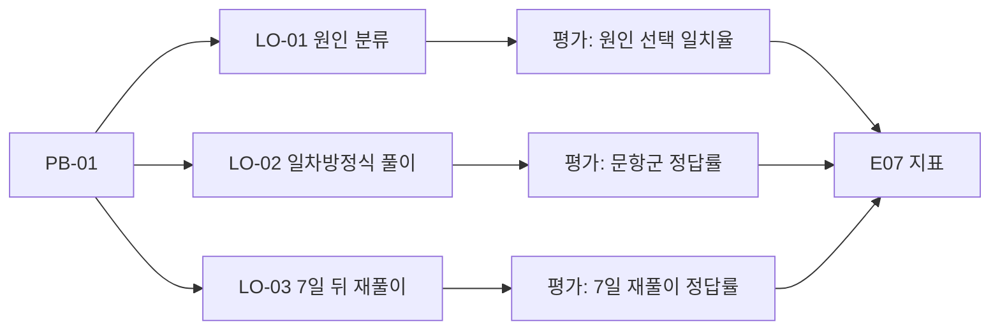

# E05 학습성과설계서

> **작성 가이드**
> - **목적**: 역방향 설계([[domain/역방향설계]])로 "학습자가 무엇을 할 수 있게 되는가 → 그것을 무엇으로 확인하는가 → 어떤 학습 경험이 필요한가"를 순서대로 정합니다. 기능은 이 문서 다음에 정합니다.
> - **입력**: E01(PB, 학습 변화 가설), E03(인사이트·오개념 관찰), E04 4절(교육과정·성취기준), [[domain/블룸분류체계]], [[domain/형성평가와피드백]], [[domain/숙달학습]], [[domain/인지부하이론]]
> - **게이트**: E01, E03, E04가 `done`이어야 합니다. **실체 검증**: 학습 목표(LO)마다 평가 증거(무엇을 보면 달성했다고 판단하는가)가 있어야 완료할 수 있습니다. 이 문서가 `done`이 되어야 E08·E09를 완료할 수 있습니다(**G-LEARN**).
> - **학습이 아닌 성과일 때**: 제품의 성과가 지식·기능 습득이 아니라 정서·습관·루틴(예: 잠자리 루틴, 독서 습관, 정서 안정)이면 LO 대신 "성과 목표(OO-01)"로 쓰고, 평가 증거 대신 관찰 가능한 행동 신호(지속 시간, 재방문, 보호자 보고)를 적습니다. 학습 목표가 전혀 없으면 `n/a`와 사유를 적고 PRD 4절 성공 지표로 대신합니다(G-LEARN은 n/a면 충족).
> - **검토 패널 제안**: 해당 교과 교사 2명 이상, 학습과학 자문, 콘텐츠·문항 담당
> - 예시 행은 샘플 제품 '매스핏'(중학생 수학 오답 코칭 앱, 학원 B2B2C + 학부모 결제, AI 오답 해설) 기준입니다.

## 1. 출발점: 문제에서 성과로

| PB | 학습 변화 가설 (E01) | 이 문서에서 정하는 LO |
|----|-------------------|---------------------|
| {PB-01} | {} | {LO-01, LO-02} |
| 예시: PB-01 | 원인 진단 + 간격 재풀이 → 같은 유형 재오답 감소 | LO-01, LO-02, LO-03 |

## 2. 1단계 — 바라는 결과 (학습 목표)

목표는 "학습자는 ~할 수 있다" 형태로, 관찰 가능한 동사로 씁니다. 블룸 수준은 [[domain/블룸분류체계]]를 따릅니다.

| ID | 학습 목표 | 성취기준·역량 매핑 | 블룸 수준 | 근거 PB·IN |
|----|---------|------------------|:---:|-----------|
| LO-01 | {학습자는 ~할 수 있다} | {성취기준 코드 또는 역량명} | {기억/이해/적용/분석/평가/창안} | {} |
| 예시: LO-01 | 학습자는 자신의 오답을 보고 오류 원인을 개념 오류·계산 실수·문제 해석 오류 중 하나로 분류하고 근거를 한 문장으로 설명할 수 있다 | 수학 교과 역량(문제해결, 의사소통) [확인 필요] | 분석 | PB-01, IN-001 |
| 예시: LO-02 | 학습자는 일차방정식을 등식의 성질로 정리해 해를 구하고 검산할 수 있다 | 중1 문자와 식 영역 성취기준 {코드} [확인 필요] | 적용 | PB-01 |
| 예시: LO-03 | 학습자는 한 번 틀린 유형의 유사 문항을 7일 뒤에 힌트 없이 풀 수 있다 | 중2 함수 영역 성취기준 {코드} | 적용 | PB-01, [[domain/간격반복]] |

### 2.1 오래 남을 이해와 핵심 질문

| LO | 오래 남을 이해 (전이 목표) | 핵심 질문 |
|----|------------------------|----------|
| {} | {} | {} |
| 예시: LO-01 | 틀린 이유를 아는 것이 같은 실수를 막는다 | "나는 이 문제를 왜 틀렸고, 다음에는 무엇을 먼저 확인할까?" |

### 2.2 선수 지식과 오개념

| LO | 선수 지식 | 흔한 오개념·오류 | 근거 |
|----|---------|----------------|------|
| {} | {} | {} | {} |
| 예시: LO-02 | 좌표평면, 일차식 계산 | 기울기를 "y절편에서 x절편까지의 거리"로 이해함, 음의 기울기 부호 누락 | `01.자료실/현장/2026-09-25_학원참관_B.md`, 콘텐츠팀 오답 샘플 분류 |

## 3. 2단계 — 수용 가능한 증거 (평가)

각 LO의 달성 여부를 무엇으로 판단하는지 정합니다. 형성평가와 총괄평가를 구분하고 [[domain/형성평가와피드백]]을 참고합니다.

| LO | 평가 증거 (무엇을 보면 달성인가) | 평가 방식 | 시점 | 달성 기준 | 데이터 출처 |
|----|-------------------------------|----------|------|----------|------------|
| LO-01 | {} | {형성/총괄, 문항/서술/관찰} | {} | {} | {E12 이벤트 후보} |
| 예시: LO-01 | 오답 원인 분류가 교사 판정과 일치하고, 설명 문장에 근거가 포함됨 | 형성: 오답마다 원인 선택 + 한 줄 설명 | 오답 직후 | 최근 10건 중 교사 판정 일치 8건 이상 | 원인 선택 이벤트, 교사 표본 채점 |
| 예시: LO-02 | 일차방정식 풀이·검산 문항 정답 | 형성: 단원 내 문항 / 총괄: 학원 단원평가 | 주 1회, 단원 말 | 해당 문항군 정답률 80% 이상 | 문항 응답 로그, 학원 단원평가 |
| 예시: LO-03 | 7일 뒤 유사 문항 힌트 없이 정답 | 형성: 간격 재출제 | 오답 후 3일·7일 | 7일 재풀이 정답률 70% 이상 | 재출제 응답 로그 |

> 평가 증거가 없는 LO는 완료할 수 없습니다(실체 검증). 증거를 정할 수 없다면 목표가 너무 추상적인 것이니 다시 씁니다.

## 4. 3단계 — 학습 계획 개요

상세 활동 설계(LA-01)는 E08에서 합니다. 여기서는 LO를 달성하려면 어떤 학습 경험이 필요한지 원칙 수준으로 적습니다.

| LO | 필요한 학습 경험 | 학습과학 근거 | 피할 것 |
|----|---------------|-------------|--------|
| {} | {} | {} | {} |
| 예시: LO-01 | 오답 직후 원인 선택 → 단계별 힌트 → 스스로 설명 | [[domain/형성평가와피드백]] | 정답·풀이 전체를 바로 보여주기 |
| 예시: LO-03 | 3일·7일 간격 유사 문항 재출제, 맞힐 때까지 반복 | [[domain/간격반복]], [[domain/인출연습]], [[domain/숙달학습]] | 같은 문항 그대로 반복 (기억 의존) |
| 예시: 공통 | 한 화면에 한 단계, 풀이 사진과 해설을 나란히 | [[domain/인지부하이론]] | 긴 텍스트 해설 한 번에 제시 |
| 예시: 공통 | 작은 성공 경험과 진행 표시, 비교·순위 노출 최소화 | [[domain/동기설계]] | 반 등수 공개 |

## 5. 측정 가능한 성과 목표

E07 북극성·학습 효과 지표의 기준이 됩니다. 기준선은 실제 데이터를 SQL로 계산해 적고, 없으면 `[가정]`과 측정 계획을 씁니다. 효과 크기 해석은 [[domain/효과크기와증거수준]]을 따릅니다.

| 성과 | 대상 LO | 기준선 | 목표 | 기간 | 비교 방법 | 계산 경로 |
|------|--------|-------|------|------|----------|----------|
| {} | {} | {} | {} | {} | {사전·사후 / 비교반} | {} |
| 예시 | LO-03 | 같은 유형 재오답률 {X}% [가정] | 기준선 대비 상대 30% 감소 [가정] | 한 학기 | 사용반 vs 미사용반 단원평가 | `automation/sql/재오답률.sql` |

## 6. 범위 밖

| 항목 | 제외 이유 |
|------|---------|
| {} | {} |
| 예시: 서술형 증명 문항 | 자동 평가 신뢰도 부족, 다음 사이클 검토 |

## 교육과정 지식그래프 연결

> 국가 교육과정(2022 개정) 기반 제품일 때 작성합니다. 도구: `/edpm-curriculum`, `automation/kg/kg_query.py`. KG는 공식 자료가 아니며, 공식 관계와 권장 순서(후보)를 구분해 씁니다. KG 릴리스: {`kg_query.py stats` 결과}

| LO | 성취기준 코드 | KG ID | 정렬 관계 | 공식 선수 성취기준 | 근거 위치 |
|----|---------------|-------|-----------|--------------------|-----------|
| {LO-01} | {[코드]} | {kr.standard…} | {assesses/supports/extends/introduces} | {`kg_query.py path` 결과} | {source p.N} |
| 예시: LO-02 | [9수02-04] | kr.standard.2022.middle.d93cd446a46ae98af0cc | assesses | 공식 선수 기록 없음 (권장 순서: [9수02-03], [6수02-01]~[6수02-05]) | kr-moe-2022-33-annex8 p.34 |

- 평가 증거를 정할 때 `kg_query.py seed <코드>`의 '달성 증거'를 출발점으로 쓰고, 우리 제품 맥락으로 다시 씁니다.
- LO의 성취기준 매핑은 `E11_교육과정매핑.csv`와 같은 코드를 씁니다.

## 완료 체크리스트

- [ ] 모든 LO가 E01의 PB에 연결되어 있다 (PB 없는 LO 없음)
- [ ] LO가 관찰 가능한 동사로 쓰였고 블룸 수준이 지정되었다
- [ ] LO마다 성취기준 코드 또는 역량 매핑이 있거나 `[확인 필요]`가 붙어 있다
- [ ] **LO마다 평가 증거, 달성 기준, 데이터 출처가 있다** (실체 검증)
- [ ] 선수 지식과 오개념이 현장 근거(E03 또는 `01.자료실/`)와 함께 적혀 있다
- [ ] 학습 계획 개요의 원칙마다 `[[domain/...]]` 근거가 있다
- [ ] 측정 가능한 성과 목표에 기준선, 비교 방법, 계산 경로가 있다
- [ ] 교과 교사 검토를 받았다 (reviewers에 기록)
- [ ] (교육과정 기반이면) 모든 LO에 KG에서 조회되는 성취기준 코드와 근거 위치가 있다
