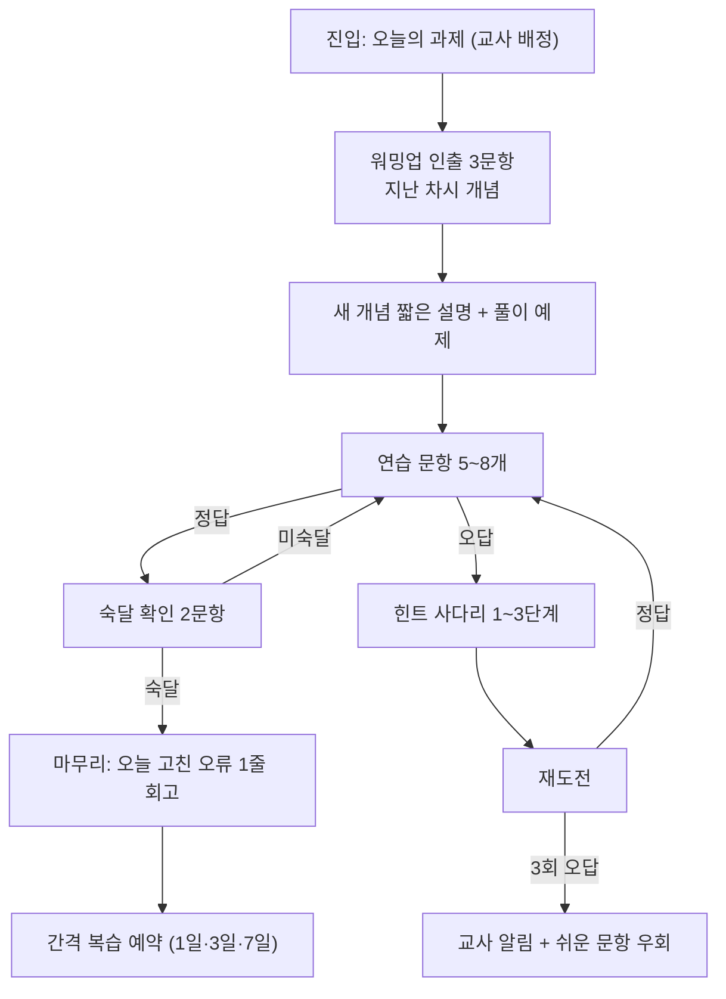
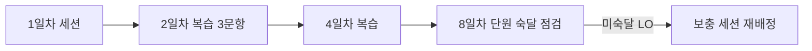

# E08 학습경험설계서

> **작성 가이드**
> - **목적**: E05의 학습 목표(LO)를 학습자가 실제로 겪는 활동(LA)과 흐름으로 바꿉니다. 기능(E09)은 이 문서의 활동을 구현하는 수단입니다.
> - **입력**: E05 학습성과설계서(LO, 평가 증거), E06 PRD(REQ), `02.wiki/learners/`, `02.wiki/domain/` 학습과학 페이지
> - **게이트**: G-LEARN — E05가 `done`이어야 이 문서를 완료할 수 있습니다. 모든 LA는 최소 하나의 LO에 연결되어야 합니다.
> - **검토 패널 (권장)**: 현직 교사 2명 이상, 학습과학 자문, 대상 연령 학습자(가상 페르소나 또는 동의받은 사용성 참여자), 보호자 대표
> - 표의 첫 행은 예시 제품 **수학 오답 코칭 앱 '매스핏'** (중학생 만 12~15세, 학원 B2B2C + 학부모 결제, AI 오답 해설) 기준입니다. 구조는 유지하고 값을 바꾸세요.

---

## 1. 설계 범위와 학습 맥락

| 항목 | 내용 |
|------|------|
| 대상 학습자 | {학년·연령·수준} — 예시: 중2, 만 13~14세, 일차방정식 단원 하위 30% |
| 대상 LO | {LO-ID 목록} — 예시: LO-01, LO-02, LO-03 |
| 학습 단위 | {과목 > 단원 > 차시} — 예시: 수학 > 일차방정식 > 3차시 (이항과 정리) |
| 사용 맥락 | {교실 / 학원 / 가정} — 예시: 학원 수업 후 가정 숙제 70%, 학원 자습실 30% |
| 1회 세션 길이 | {분} — 예시: 15~20분 (아래 6절 기준) |
| 사용 기기 | {기기·네트워크} — 예시: 학생 개인 스마트폰, 학원 공용 태블릿 |
| 근거 페르소나 | {[[learners/…]]} |

## 2. 학습 흐름 (세션·단원 단위)

> 한 세션의 흐름을 먼저 그리고, 단원 전체에서 세션이 어떻게 반복·간격을 두는지 둘째 그림에 그립니다. 근거: [[domain/역방향설계]], [[domain/숙달학습]]

## 3. 학습 활동 (LA)

> 교수 전략은 다음 중에서 고르고, 근거 위키 페이지를 적습니다: 직접 교수, 풀이 예제(worked example), 인출 연습, 간격 복습, 숙달 확인, 그 밖의 전략은 위키 페이지를 먼저 만듭니다.

| LA-ID | 활동명 | 연결 LO | 교수 전략 | 근거 | 학습자 행동 | 평가 증거 (E05와 일치) | 소요 | 맥락 |
|-------|--------|---------|-----------|------|-------------|------------------------|------|------|
| LA-01 (예시) | 워밍업 인출 | LO-01 | 인출 연습 | [[domain/인출연습]] | 지난 차시 이항 규칙 3문항을 힌트 없이 푼다 | 3문항 중 2문항 이상 정답 | 3분 | 가정·학원 |
| LA-02 (예시) | 풀이 예제 비교 | LO-02 | 풀이 예제 | [[domain/인지부하이론]] | 바른 풀이와 흔한 오답 풀이를 나란히 보고 틀린 줄을 고른다 | 오류 줄 선택 정확도 | 4분 | 가정 |
| LA-03 (예시) | 오답 코칭 재도전 | LO-02 | 형성 피드백 + 힌트 사다리 | [[domain/형성평가와피드백]] | 틀린 문항에서 자기 풀이의 오류 단계를 표시하고 다시 푼다 | 재도전 정답률, 오류 단계 표시 정확도 | 5분 | 가정 |
| LA-04 (예시) | 숙달 확인 | LO-01, LO-02 | 숙달 확인 | [[domain/숙달학습]] | 새 수치의 문항 2개를 연속 정답 | 2연속 정답 = 숙달 | 2분 | 가정·학원 |
| LA-05 (예시) | 간격 복습 | LO-01~03 | 간격 복습 | [[domain/간격반복]] | 1·3·7일 후 3문항씩 다시 푼다 | 7일차 정답률 | 3분×3 | 가정 |
| {LA-0N} | {활동명} | {LO-ID} | {전략} | {[[domain/…]]} | {관찰 가능한 행동} | {판단 기준} | {분} | {교실/가정} |

**LO 커버리지 점검**: 모든 LO가 최소 1개 LA에 연결되었는지, 평가 증거가 E05와 같은 기준인지 확인합니다.

| LO-ID | 연결 LA | 평가 LA | 누락 여부 |
|-------|---------|---------|-----------|
| LO-02 (예시) | LA-02, LA-03 | LA-04 | 없음 |
| {LO-0N} | {LA} | {LA} | {있음/없음} |

## 4. 피드백 루프

근거: [[domain/형성평가와피드백]]

| 구분 | 시점 | 내용 | 대상 LA | 예시 (매스핏) |
|------|------|------|---------|---------------|
| 즉시 피드백 | 응답 직후 | 정오 + 어느 단계가 틀렸는지 | {LA} | 정답 여부와 "이항할 때 부호를 확인해 볼까요?" 표시 |
| 지연 피드백 | 세션 종료·다음 날 | 오류 패턴 요약, 복습 과제 | {LA} | "이번 주 부호 실수 4회 → 복습 3문항 예약" |
| 교사 피드백 | 주 1회 또는 알림 시 | 학급 공통 오개념, 개별 코멘트 | {LA} | 학원 강사가 다음 수업 도입 5분에 공통 오류 설명 |

**힌트 사다리** (정답을 먼저 주지 않습니다)

| 단계 | 제공 내용 | 열리는 조건 | 예시 (일차방정식) |
|------|-----------|-------------|-------------------|
| 0 | 다시 생각해 보기 안내 | 첫 오답 | "풀이를 한 줄씩 다시 읽어 보세요." |
| 1 | 오류 위치 힌트 | 재도전 오답 또는 학습자 요청 | "3번째 줄에서 무언가 바뀌었어요." |
| 2 | 개념 힌트 | 1단계 후 오답 | "등호 반대편으로 옮기면 부호가 어떻게 되나요?" |
| 3 | 유사 문항 풀이 예제 | 2단계 후 오답 | 수치가 다른 같은 유형의 풀이 전체 |
| 4 | 정답과 해설 | 3단계 후에도 오답, 또는 교사 설정 | 정답 공개 + 교사 알림 |

## 5. 동기 설계

근거: [[domain/동기설계]] (자기결정성 이론: 자율성·유능감·관계성)

| 욕구 | 설계 요소 | 예시 (매스핏) | 피할 것 |
|------|-----------|---------------|---------|
| 자율성 | {선택권} | 복습 순서·문항 테마 선택 | 강제 연속 접속(스트릭 끊김 벌칙) |
| 유능감 | {성장 가시화} | "지난주보다 부호 실수 50% 감소" 같은 자기 비교 | 학급 공개 순위표, 오답 수 공개 |
| 관계성 | {연결감} | 강사의 짧은 칭찬 코멘트 | 학생 간 비교 알림 |

**해로운 게이미피케이션 점검**: 다음에 해당하면 E13 아동 안전 항목에 올립니다.

- [ ] 학습과 무관한 보상(뽑기, 랜덤 박스, 유료 재화)이 없다
- [ ] 공개 순위·실패 노출로 수치심을 주지 않는다
- [ ] 늦은 밤 푸시, 이탈 시 죄책감 문구가 없다
- [ ] 보상이 정답 수가 아니라 노력·개선(재도전, 오류 수정)에 연결된다

## 6. 연령별 세션 길이와 인지부하

근거: [[domain/인지부하이론]]

| 연령대 | 권장 1회 세션 | 한 화면 새 요소 | 비고 |
|--------|---------------|-----------------|------|
| 초등 저학년 (만 7~9세) | 10~15분 [가정] | 1개 | 음성 안내 병행 |
| 초등 고학년 (만 10~12세) | 15~20분 [가정] | 1~2개 | |
| 중학생 (만 12~15세) (예시) | 15~25분 [가정] | 2개 이하 | 매스핏 기본 20분 |
| 고등·성인 | 25~40분 [가정] | 2~3개 | |

수치는 회사 데이터나 위키 근거로 바꾸고 `[가정]`을 지웁니다.

| 점검 항목 | 판정 | 메모 |
|-----------|------|------|
| 새 개념 설명과 연습이 한 화면에 섞이지 않는다 | {예/아니오} | |
| 풀이 예제 → 부분 완성 → 독립 풀이 순으로 도움이 줄어든다 | {예/아니오} | |
| 지시문이 대상 학년 읽기 수준이다 (E10 연령 UI 규칙) | {예/아니오} | |
| 불필요한 장식 애니메이션·효과음이 없다 | {예/아니오} | |

## 7. 수준별 학습 (차별화)

| 수준 | 판정 기준 | 경로 차이 | 예시 |
|------|-----------|-----------|------|
| 보충 | {진단 결과} | {경로} | 진단 40점 미만: 선수 개념(정수 계산) 5문항 먼저 |
| 기본 | {기준} | {경로} | 표준 흐름 |
| 심화 | {기준} | {경로} | 숙달 후 서술형 응용 1문항 추가 |

수준 이동은 교사가 언제든 바꿀 수 있어야 합니다(8절 교사 개입).

## 8. 교사 개입 지점 (teacher-in-the-loop)

근거: [[domain/교사참여설계]]

| 지점 | 트리거 | 교사가 보는 것 | 교사 행동 | 예시 |
|------|--------|----------------|-----------|------|
| 과제 배정 | 수업 후 | 단원·난이도 | 차시별 과제 배정 | 강사가 3차시 숙제 배정 |
| 막힘 알림 | {조건} | {정보} | {행동} | 같은 문항 3회 오답 → 학생·문항·오류 단계 표시 → 다음 수업 개별 지도 |
| 주간 점검 | 주 1회 | 반 공통 오개념 상위 3개 | 수업 도입 재설명 | |
| AI 생성물 승인 | AI가 유사 문항 생성 시 | 생성 문항 미리보기 | 승인/수정/반려 (E14) | |

## 9. 보호자 접점

| 접점 | 빈도 | 내용 | 주의 |
|------|------|------|------|
| 주간 학습 리포트 (예시) | 주 1회 | 학습 시간, 숙달 단원, 강사 코멘트 | 점수 순위·타 학생 비교 금지 |
| 가입·동의 | 최초 1회 | 만 14세 미만 법정대리인 동의 (E13) | |
| {접점} | {빈도} | {내용} | {주의} |

## 10. 교실과 가정 맥락 차이

| 항목 | 교실·학원 | 가정 |
|------|-----------|------|
| 도움 주체 | 교사·강사 즉시 | AI 힌트, 보호자 (수학 지도 어려움 가정) |
| 기기 | 공용 태블릿 (로그아웃 필수) | 개인 스마트폰 |
| 소리 | 무음 기본 | 선택 |
| 세션 시작 | 교사 지시 | 알림 (오후 9시 이후 금지 [가정]) |

---

## 교육과정 지식그래프 연결

> 국가 교육과정(2022 개정) 기반 제품일 때 작성합니다. 도구: `/edpm-curriculum`, `automation/kg/kg_query.py`. KG는 공식 자료가 아니며, 공식 관계와 권장 순서(후보)를 구분해 씁니다. KG 릴리스: {`kg_query.py stats` 결과}

| 학습 흐름 구간 | 근거 관계 | 명령 | 설계 반영 |
|----------------|-----------|------|-----------|
| {LA-0x → LA-0y} | {공식 / 권장 순서} | `kg_query.py path <코드> --layer all` | {순서 고정 / 권장 표시} |
| 예시: 비례식 복습 → 일차방정식 | 권장 순서(초→중 영역 연속) | `path "[9수02-04]" --layer all` | 진입 진단에서 막히면 비례식 복습 제안 (필수 아님) |

- 공식 관계는 학습 경로의 잠금 조건 후보로, 권장 순서는 추천 순서로만 씁니다.
- 학습 묶음(cluster)과 학부모용 요약(parentSummary, 초등)은 단원 단위 화면·리포트 설계에 참고합니다.

## 완료 체크리스트

- [ ] 모든 LA가 하나 이상의 LO에 연결되고, 모든 LO가 하나 이상의 LA를 가진다
- [ ] 교수 전략마다 `[[domain/…]]` 근거가 있다
- [ ] 세션 흐름과 단원(간격) 흐름이 Mermaid로 그려져 있다
- [ ] 힌트 사다리에서 정답 공개가 마지막 단계다
- [ ] 해로운 게이미피케이션 점검 4항목이 확인되었다
- [ ] 연령별 세션 길이와 인지부하 점검이 채워졌다
- [ ] 교사 개입 지점과 보호자 접점이 정의되었다
- [ ] 교사 패널 검토(`/edpm-review E08`)를 거쳤다
- [ ] E05가 `done`이다 (G-LEARN)
- [ ] (교육과정 기반이면) 학습 순서의 근거가 공식 관계인지 권장 순서인지 구분해 적었다
