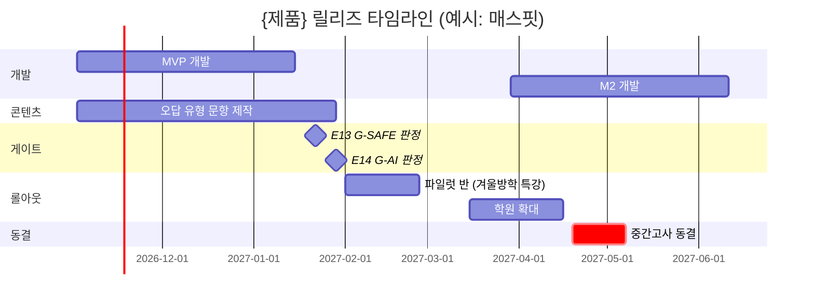
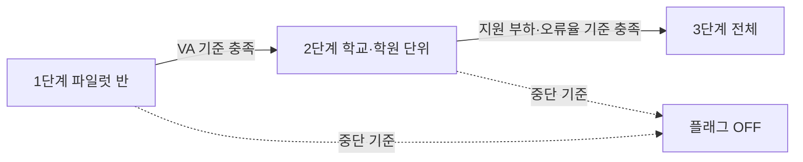

# E15 릴리즈계획서

> **작성 가이드**
> - **목적**: 무엇을(F-ID), 언제(학사일정 기준), 누구에게(롤아웃 단계) 내보내는지 한 장으로 합의합니다. 개발 일정이 아니라 **교실에 들어가는 날**을 기준으로 계획합니다.
> - **입력**: E09 기능명세서(F-ID, 인수조건), E10 화면·정보구조설계서(SCR-ID), E11 콘텐츠·문항설계서(콘텐츠 제작량), E13·E14 게이트 판정, [[domain/학사일정]], 회사 학사 캘린더.
> - **게이트**: G-SAFE(미성년·학생 데이터면 E13 `done` + 출시 차단 0건), G-AI(AI 기능이면 E14 `done` + 평가 기준 합격), G-CAL(주요 일정의 학사일정 충돌 검토). 하나라도 미충족이면 `status: done` 불가.
> - **추천 검토 패널**: 개발 리드, 콘텐츠 리드, CS 리드, 교사 패널 1~2명 (`/edpm-review E15`).

## 1. 릴리즈 개요

| 항목 | 내용 |
|------|------|
| 제품 | {제품명} |
| 릴리즈 단위 | {MVP / M2 / M3} |
| 대상 사업 유형 | {E00 기준} |
| 기준 학사 연도 | {YYYY학년도} |
| 최종 목표 시점 | {예: 신학기 3월 2주차 교실 사용 시작} |
| 예시 | 매스핏 — MVP를 2027학년도 1학기 중간고사 대비 기간(4월) 전, 3월 3주차 학원 시범반에 투입 |

## 2. 릴리즈별 범위

E09의 F-ID 단위로 범위를 정합니다. 각 기능이 어떤 학습 목표(LO)를 위한 것인지 추적되어야 합니다. LO와 연결되지 않는 기능은 범위에서 빼거나 근거를 적습니다.

| 릴리즈 | F-ID | 기능명 | 연결 LO | 연결 SCR | 콘텐츠 의존 (CT) | 우선순위 |
|--------|------|--------|---------|----------|------------------|----------|
| {MVP} | {F-001} | {기능명} | {LO-01} | {SCR-001} | {CT-01} | {P0} |
| 예시 MVP | F-012 | AI 오답 해설 (단계별 힌트) | LO-01 | SCR-004 | CT-02 일차방정식 오답 유형 120문항 | P0 |

| 릴리즈 | 목표 | 제외 범위 (다음 릴리즈로) |
|--------|------|---------------------------|
| MVP | {핵심 학습 루프 검증} | {…} |
| M2 | {교사 운영 기능 확장} | {…} |
| M3 | {확산·연동} | {…} |

## 3. 학사일정 정렬 마일스톤 (G-CAL)

일정은 [[domain/학사일정]]과 회사 학사 캘린더를 먼저 확인하고 정합니다. 확인되지 않은 날짜는 `[확인 필요]`로 표시합니다.

| 학사 이벤트 | 기간 | 제품 영향 | 대응 |
|-------------|------|-----------|------|
| 신학기 | 3월 1~2주 | 교사·학원 반 편성, 계정 생성 몰림 | 신규 기능 배포 금지, 온보딩 지원 집중 |
| 중간고사 | {4월 말~5월 초} | 시험 대비 사용량 급증 | 변경 동결, 서버 증설 |
| 기말고사 | {6월 말~7월 초 / 12월} | 사용량 급증 | 변경 동결 |
| 여름·겨울방학 | {7월 말~8월 / 1~2월} | 학교 사용 감소, 학원 특강 증가 | 대형 배포·마이그레이션 적기 |
| 수능 | {11월 셋째 주 목} | 고3 대상 서비스 영향, 학원 일정 변동 | 고등 대상이면 동결 |
| 학교 예산 편성 | {전년도 하반기~2월} [확인 필요] | 다음 학년도 도입 결정 | E18 영업 일정과 연동 |

| 마일스톤 ID | 마일스톤 | 목표일 | 학사 충돌 검토 | 담당 |
|-------------|----------|--------|----------------|------|
| {MS-01} | {…} | {YYYY-MM-DD} | {충돌 없음 / 조정함: 사유} | {…} |
| 예시 MS-02 | MVP 파일럿 반 투입 | 2027-02-01 | 겨울방학 특강 기간으로 조정 (원래 3월 2주 → 신학기 충돌) | PM |

## 4. 개발·콘텐츠 제작 의존관계

에듀테크 릴리즈는 코드보다 콘텐츠(문항, 해설, 검수)가 늦어지는 경우가 많습니다. 두 트랙을 같은 표에 둡니다.

| 의존 ID | 선행 작업 | 후행 작업 | 트랙 | 리드타임 | 상태 |
|---------|-----------|-----------|------|----------|------|
| {DEP-01} | {…} | {…} | {개발/콘텐츠/검수/외부} | {…주} | {…} |
| 예시 DEP-02 | 오답 유형 120문항 교사 검수 (CT-02) | F-003 AI 해설 평가세트 확정 | 콘텐츠 → AI | 3주 | 진행 중 |

## 5. 게이트 상태

| 게이트 | 해당 여부 | 근거 문서 | 판정 | 미해결 항목 | 판정일 |
|--------|-----------|-----------|------|-------------|--------|
| G-SAFE | {예/아니오} | [[03.docs/3.설계/E13_안전개인정보접근성평가서]] | {통과/미통과} | {출시 차단 RK-ID} | {…} |
| G-AI | {예/아니오} | [[03.docs/3.설계/E14_AI학습기능설계서]], `E14_평가세트.csv` | {통과/미통과} | {미달 기준} | {…} |
| G-CAL | 예 | 본 문서 3장, [[domain/학사일정]] | {검토 완료/미완료} | {…} | {…} |
| 예시 G-AI | 예 | E14, 평가세트 32건 | 미통과 | 정답 직접 노출 2건 (GR-02 위반) | 2027-01-29 |

## 6. 기능 플래그와 롤아웃

| 플래그 | 대상 F-ID | 1단계 파일럿 반 | 2단계 학교·학원 | 3단계 전체 | 진행 기준 | 중단 기준 |
|--------|-----------|-----------------|-----------------|------------|-----------|-----------|
| {flag_name} | {F-001} | {대상·기간} | {대상·기간} | {시점} | {…} | {…} |
| 예시 ai_hint_v1 | F-003 | 학원 2곳 4개 반 | 학원 15곳 | 2027-04-12 | 힌트 후 재시도 정답률 기준 충족, 오류 신고 주 3건 이하 | 부적절 응답 신고 1건 이상 즉시 OFF |

롤아웃 단계와 파일럿 설계는 E16 검증계획서와 맞춥니다. 학습자 연령·동의 조건은 [[domain/아동개인정보보호]] 기준을 따릅니다.

## 7. 지원 준비도

| 항목 | 준비 내용 | 담당 | 완료일 | 상태 |
|------|-----------|------|--------|------|
| 교사·원장용 가이드 | {…} | {…} | {…} | {…} |
| 학부모 안내문 | {보호자 동의 포함} | {…} | {…} | {…} |
| CS 응대 스크립트·FAQ | {…} | {…} | {…} | {…} |
| 장애·오류 신고 경로 | {…} | {…} | {…} | {…} |
| 예시 CS FAQ | AI 해설이 틀렸을 때 신고 방법, 학부모 리포트 미수신 대응 12문항 | CS 리드 | 2027-01-25 | 완료 |

## 8. 변경 동결 기간

| 동결 ID | 기간 | 사유 | 허용 예외 |
|---------|------|------|-----------|
| {FZ-01} | {…} | {중간고사 / 신학기 / 수능} | {보안·장애 핫픽스만} |
| 예시 FZ-01 | 2027-04-19 ~ 05-07 | 중학교 1학기 중간고사 | 보안 패치, 오답 해설 오류 수정 |

## 9. 위험

| 위험 ID | 내용 | 영향 | 가능성 | 대응 | 담당 |
|---------|------|------|--------|------|------|
| {RL-01} | {…} | {상/중/하} | {상/중/하} | {…} | {…} |
| 예시 RL-01 | 문항 검수 지연으로 신학기 전 콘텐츠 부족 | 상 | 중 | 범위를 1단원으로 축소, 검수 교사 2명 추가 | 콘텐츠 리드 |

## 완료 체크리스트

- [ ] 모든 범위 기능에 F-ID와 연결 LO가 있다 (LO 없는 기능은 제외 또는 근거 기재)
- [ ] 마일스톤마다 [[domain/학사일정]] 충돌 검토 결과가 있다 (G-CAL)
- [ ] 미확인 날짜(시험, 예산 시기)는 `[확인 필요]`로 표시했다
- [ ] 콘텐츠 제작·검수 의존관계가 개발 일정과 함께 있다
- [ ] G-SAFE, G-AI 판정이 E13·E14 링크와 함께 기록되었다 (해당 없음이면 사유)
- [ ] 롤아웃 단계별 진행·중단 기준이 수치로 있다
- [ ] 교사·학부모·CS 지원 자료 준비 상태가 표에 있다
- [ ] 변경 동결 기간이 정해졌다
- [ ] 검토 패널 의견을 반영하고 `02.wiki/log.md`에 완료를 기록했다
