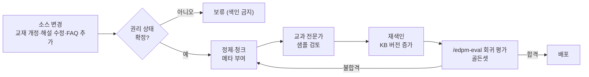

# A01 지식베이스설계서

> **작성 가이드**
> - **목적**: 구성 요소 `근거`가 있는 AI 기능(교과·교재·FAQ·교사용 지도서 근거 답변)가 검색할 지식의 범위, 출처별 권리 상태, 정제·청크·메타데이터 규칙, 갱신 절차를 정합니다. "무엇을 근거로 답하는가"가 이 문서에서 결정됩니다.
> - **입력**: E14 AI 기능(AI-ID, 구성 요소 `근거`)·가드레일(GR), E11 콘텐츠 구조·메타데이터·오개념 사전·저작권 점검, [[domain/교육저작권]]
> - **게이트**: AI-TECH 모듈. 실체 검증: **지식 소스마다 저작권·이용 허락 상태가 기재**되어야 `done` 처리할 수 있습니다. "확인 중"이 남은 소스는 색인하지 않습니다.
> - **원칙**: 명단·점수·출결·날짜 같은 사실 데이터는 지식베이스에 넣지 않습니다. 그런 값은 SQL로 조회합니다(A05). 벡터 검색은 설명형 텍스트에만 씁니다.
> - **스킬**: `/edpm-ai-design A01` — E11·E14를 읽고 소스 인벤토리 초안을 만듭니다. 권리 상태는 사람이 확정합니다.
> - **검토 패널 (권장)**: AI 엔지니어, 교과 전문가, 교사, 개인정보 담당 (+ 저작권 담당)
> - 표의 첫 행은 예시 제품 **매스핏**(중학생 만 12~15세, 학원 B2B2C + 학부모 결제, AI 오답 해설, E14 AI-01 = 역할 T, 근거 + 학습자상태 + 대화) 기준입니다.

---

## 1. 대상 AI 기능과 답변 범위

| AI-ID | 기능 | 답변 범위 (포함) | 답변 범위 (제외) | 근거 없을 때 |
|-------|------|------------------|------------------|--------------|
| AI-01 (예시) | 오답 단계별 힌트 해설 (F-012) | 중1~3 수학 교육과정 개념, 자사 문항 해설, 오개념 설명 | 고등 과정 풀이법, 타 교과, 시험 일정·성적 문의 | 거절 + 정적 힌트 (A03 고정 문구) |
| {AI-0N} | {기능} | {범위} | {제외} | {처리} |

## 2. 소스 인벤토리 (KB)

> 권리 상태 값: 자체 저작 / 라이선스 계약(범위 명시) / 공공누리(유형) / CC(조건) / 이용 허락 서면 / 확인 중. "확인 중"은 색인 금지. 교과서 본문·기출은 "교육 목적"만으로 허용되지 않습니다 ([[domain/교육저작권]]).

| KB-ID | 소스 | 형식 | 분량 | 저작권·이용허락 상태 | 근거 문서 | 공개범위 | 신선도 책임자 | 갱신 주기 |
|-------|------|------|------|----------------------|-----------|----------|---------------|-----------|
| KB-01 (예시) | 2022 개정 교육과정 수학과 (중학교) | PDF | {쪽} | 공공저작물 [확인 필요: 공공누리 유형] | `01.자료실/정책/` 원본 | 학습자·교사 | {교과 전문가} | 개정 고시 시 |
| KB-02 | 자사 교재·개념 해설 | {DOCX/HWP} | {} | {자체 저작} | {계약·내부 규정} | {} | {콘텐츠팀} | {학기} |
| KB-03 | 문항 해설·힌트 (E11 ITEM 메타 포함) | {CMS 내보내기} | {} | {자체 저작} | E11 2절 | {} | {} | {배포 시} |
| KB-04 | 오개념 사전 (MC-xx) | {표} | {} | {} | E11 2절 | {} | {} | {} |
| KB-05 | FAQ (학습자·학부모) | {} | {} | {} | {} | {} | {CS팀} | {} |
| KB-06 | 교사용 자료·지도서 | {} | {} | {확인 중 → 색인 금지} | {} | 교사만 | {} | {} |
| {KB-0N} | {소스} | {} | {} | {} | {} | {} | {} | {} |

## 3. 정제 규칙

| 대상 | 규칙 | 이유 | 예시 |
|------|------|------|------|
| 수식 | LaTeX로 보존 (`$2x+3=7$`), 이미지 수식은 OCR 후 사람 확인 | 수식이 깨지면 해설 의미가 바뀜 | 예시: `2x + 3 = 7` → `$2x+3=7$` |
| 표 | 행 단위 문장으로 펼치거나 마크다운 표 유지, 머리글 반복 | 표가 쪼개지면 열 의미 상실 | {} |
| 그림·그래프 | 대체텍스트(무엇을 보여주는지)로 치환, 원본 위치 링크 | 텍스트 검색 대상화, 접근성(E13 c5) | {} |
| 학년·단원 메타 | 문서 머리말·파일 경로에서 추출, 없으면 사람 입력 | 학년 필터의 기준 (A02) | {} |
| 개인정보 | 해설·FAQ에 학생 이름·학원명이 있으면 제거 | G-PII | {} |
| 중복 | 같은 해설의 구버전은 색인 제외, 최신 버전만 | 상충 답변 방지 | {} |
| 머리글·쪽번호·광고 문구 | 제거 | 검색 잡음 | {} |

## 4. 청크 규칙 (콘텐츠 유형별)

| 콘텐츠 유형 | 청크 단위 | 크기 목표 | 겹침 | 반드시 함께 둘 것 | 예시 |
|-------------|-----------|-----------|------|-------------------|------|
| 교육과정 성취기준 | 성취기준 1개 | {토큰} | 없음 | 코드, 해설 | 예시: 성취기준 1개 + 성취기준 해설 = 1청크 |
| 개념 해설 | 소제목(개념) 단위 | {300~600토큰} [가정] | {1~2문장} | 정의 + 대표 예제 | {} |
| 문항 해설 | 문항 1개 (본문+정답+해설+힌트 단계) | 문항 단위 | 없음 | item_id, 오개념 tag | {} |
| 오개념 사전 | 오개념 1개 | 짧음 | 없음 | 증상, 원인, 교정 질문 | 예시: MC-07 이항 시 부호 미변경 |
| FAQ | 질문-답 1쌍 | 짧음 | 없음 | 질문 원문 | {} |
| 교사용 자료 | 차시·활동 단위 | {} | {} | 차시, 학습 목표 | {} |

## 5. 메타데이터 스키마

| 필드 | 필수 | 값 | 용도 | 예시 |
|------|:---:|-----|------|------|
| kb_id | 필수 | KB-ID | 출처 추적 | KB-03 |
| 학년 | 필수 | 중1/중2/중3 (복수 가능) | 학년 필터 (중1에게 고등 내용 차단) | 중1 |
| 단원 | 필수 | 단원 코드 (E11) | 단원 필터, GR-05 | 일차방정식 |
| 성취기준 코드 | 권장 | 교육과정 코드 [확인 필요: 표기] | 교육과정 정합 | {코드} |
| 난이도 | 문항만 | 1~5 (E11) | 수준별 예시 선택 | 2 |
| 출처 | 필수 | 문서명·쪽·item_id | 인용 표시 (A02) | 매스핏 해설 ITEM-00231 |
| 버전 | 필수 | v번호 + 날짜 | 구버전 제외, A06 평가 기록 | v2 2026-09-30 |
| 공개범위 | 필수 | 학습자 / 교사 / 내부 | 역할별 필터 | 학습자 |
| 권리 상태 | 필수 | 2절 값 | 색인 허용 판단 | 자체 저작 |
| AI 생성 여부 | 필수 | E11 값 | 검수 확인 | 없음 |

## 6. 학생 표현 사전 (동의어)

> 학생들이 실제로 쓰는 말을 교과 용어로 연결합니다. 검색 질의 확장과 응답 어휘 조정(A03, GR-04)에 함께 씁니다. 출처는 비식별화된 질문 로그·인터뷰(`01.자료실/현장/`)입니다.

| 학생 표현 | 교과 용어 | 학년 | 출처 | 비고 |
|-----------|-----------|------|------|------|
| 넘기다, 건너편으로 보내다 (예시) | 이항 | 중1 | {질문 로그 집계} | 예시 행 |
| {엑스 구하기} | {방정식의 해} | {} | {} | {} |
| {괄호 푸는 거} | {분배법칙} | {} | {} | {} |

## 7. 갱신 워크플로

| 이벤트 | 담당 | 기한 | 회귀 평가 |
|--------|------|------|-----------|
| 문항 해설 오류 확정 (E11 신고) | {콘텐츠팀} | 24시간 내 비노출·재색인 [가정] | 해당 단원 골든셋 |
| 교재 개정 | {} | {} | 전체 골든셋 |
| 교육과정 개정 고시 | {} | {} | 전체 + 범위 재검토 |

## 8. P3 노코드 점검 기록

> P3 노코드 점검(`/edpm-ai-design nocode`): 본 구축 전에 소스 일부를 노코드 도구(예: 문서 업로드형 챗봇, 노트형 AI 도구)에 넣고 10개 질문을 해서 "이 소스로 답이 되는가"를 먼저 봅니다. 학생 데이터는 넣지 않고, 권리 상태가 확정된 소스만 씁니다. 질문은 이후 골든셋(`골든셋.csv`)의 씨앗이 됩니다.

| 항목 | 내용 |
|------|------|
| 일자·도구 | {YYYY-MM-DD} / {도구명} |
| 넣은 소스 | {KB-03 일차방정식 단원 해설 40문항} |
| 질문 수 | 10 |
| 결과 요약 | {근거 있는 답 n / 근거 없음 n / 틀린 답 n} |

| # | 질문 | 근거 찾음 | 답 정확 | 관찰 | 조치 |
|---|------|:---:|:---:|------|------|
| 1 (예시) | "이항하면 왜 부호가 바뀌어요?" | O | O | 등식의 성질 설명은 맞으나 고등 용어 사용 | 학생 표현 사전·GR-04 반영 |
| {2} | {} | {} | {} | {} | {} |

---

## 교육과정 지식그래프 연결

> 국가 교육과정(2022 개정) 기반 제품일 때 작성합니다. 도구: `/edpm-curriculum`, `automation/kg/kg_query.py`. KG는 공식 자료가 아니며, 공식 관계와 권장 순서(후보)를 구분해 씁니다. KG 릴리스: {`kg_query.py stats` 결과}

| 소스 | 저장 방식 | 이유 |
|------|-----------|------|
| KG 성취기준·토픽·선수 관계 | **SQL 테이블 그대로** (kg.db 또는 서비스 DB로 이관) | 코드·관계 조회는 정확해야 하므로 벡터 검색에 맡기지 않음 |
| 성취기준 요약·토픽 설명 | (선택) 임베딩 후 검색 | 학생 질문 → 관련 성취기준 찾기 |
| 평가 증거·오개념 초안 | 감수 후 오개념 사전(KB)에 편입 | 초안 상태로 학생에게 노출 금지 |

- 라이선스: MIT (저작권 표시 유지), 공식 근거 문서 출처 기재. 저작권·이용허락 열에 반영합니다.

## 완료 체크리스트

- [ ] 대상 AI 기능과 답변 범위·제외 범위가 정해졌다
- [ ] 모든 KB 소스에 저작권·이용허락 상태와 근거 문서가 있다 (실체 검증) — "확인 중"은 색인 제외
- [ ] 소스마다 신선도 책임자와 갱신 주기가 있다
- [ ] 수식·표·그림 정제 규칙과 학년·단원 메타 추출 방법이 있다
- [ ] 콘텐츠 유형별 청크 규칙이 있다
- [ ] 메타데이터에 학년·단원·공개범위·버전이 필수로 들어간다
- [ ] 명단·점수·날짜 같은 사실 데이터가 지식베이스에 없다
- [ ] 학생 표현 사전 초안이 있다
- [ ] 갱신 워크플로에 회귀 평가(`/edpm-eval`)가 연결되었다
- [ ] P3 노코드 점검 10문항 기록이 있고 골든셋으로 옮겼다
- [ ] (교육과정 기반이면) KG 데이터의 저장 방식(SQL/임베딩)과 라이선스 표시가 정해졌다
