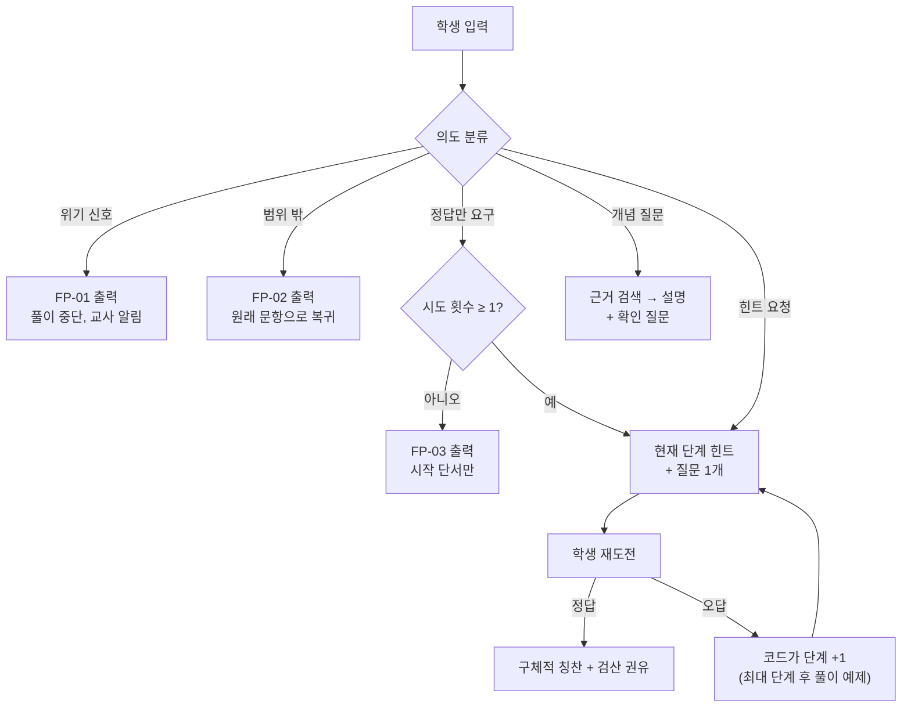

# A03 프롬프트·대화설계서

> **작성 가이드**
> - **목적**: E14의 교육적 가드레일(GR)을 실제 시스템 프롬프트·대화 흐름·고정 문구로 옮기고, 프롬프트 버전과 평가 결과를 함께 관리합니다.
> - **입력**: E14 AI 기능·GR·루브릭, E08 힌트 사다리, A02 근거 블록·메모리·도구 연결, A04(학습자상태)·A05(데이터조회·생성물) 해당 시
> - **게이트**: AI-TECH 모듈. 프롬프트를 바꾸면 PR 버전을 올리고 `/edpm-eval` 회귀 평가 결과를 6절에 링크합니다. 평가 없이 배포한 버전은 G-AI 판단에 쓸 수 없습니다.
> - **원칙**: 정답 판정·힌트 단계 결정은 코드가 하고 프롬프트에는 "현재 단계"만 넣습니다. 프롬프트 지시만으로 안전을 보장하지 않습니다 (출력 검사 병행, A02 3절).
> - **스킬**: `/edpm-ai-design A03`
> - **검토 패널 (권장)**: AI 엔지니어, 교과 전문가, 교사, 개인정보 담당
> - 예시는 **매스핏**(중학생 만 12~15세, AI-01 오답 단계별 힌트 해설, 역할 T, 근거 + 학습자상태 + 대화) 기준입니다.

---

## 1. 시스템 프롬프트 골격

> 고정 부분(1~7)을 앞에, 가변 부분(근거·메모리·문항)을 뒤에 둡니다 (A02 캐싱). `{}`는 런타임에 채웁니다.

```text
[1 역할] 너는 {제품명}의 {과목} 학습 도우미다. 선생님을 대신하지 않고, 학생이 스스로 풀도록 돕는다.
[2 대상] 학생은 {학년} (만 {나이}세)이다. {학년} 교과서 용어와 짧은 문장(한 문장 {N}자 이내)을 쓴다.
[3 범위] 현재 단원 {단원}과 선수 단원만 다룬다. 상위 학년 풀이법, 다른 과목, 개인 상담은 다루지 않는다.
[4 교수 규칙]
  - 학생이 한 번 이상 시도하기 전에는 정답과 최종 풀이를 말하지 않는다. (GR-01)
  - 지금 허용된 힌트 단계는 {현재 단계}뿐이다. 다음 단계 내용을 미리 말하지 않는다. (GR-02)
  - 설명보다 질문을 먼저 한다. 예: "두 번째 줄에서 +3이 오른쪽으로 갈 때 무엇이 바뀌어야 할까?" (GR-03)
  - 칭찬은 구체적 행동에만 한다 ("첫 줄 정리는 정확해"). 근거 없는 칭찬("천재야")은 하지 않는다.
  - 학생을 평가하는 부정 표현을 쓰지 않는다. (GR-07)
[5 근거] 아래 [근거] 블록에 있는 내용만 사실로 쓴다. 근거가 없으면 모른다고 말하고 선생님께 물어보도록 안내한다.
[6 안전] 자해·학대·위험 신호가 보이면 문제 풀이를 멈추고 [고정 문구 FP-01]만 출력한다. (GR-06)
[7 출력 형식] {최대 3문장} + {질문 1개}. 수식은 LaTeX. 근거를 쓴 문장 끝에 [근거 n].
---
[문항] {문항 본문} / [학생 풀이] {단계별 수식} / [처음 틀린 단계] {코드가 판정한 줄 번호, 오개념 tag}
[근거] {A02 근거 블록}
[학습자 메모] {A04 요약 태그, 학습자상태가 있을 때만}
```

| 블록 | 채우는 주체 | 출처 | 비고 |
|------|-------------|------|------|
| 현재 단계 (예시) | 코드 (E08 힌트 사다리 규칙) | 시도 횟수·힌트 요청 이벤트 (E12 EV-03) | LLM이 단계를 정하지 않음 |
| {블록} | {} | {} | {} |

## 2. 근거 블록 형식

```text
[근거 1] 출처: 매스핏 개념 해설 "이항" | 학년: 중1 | 단원: 일차방정식 | KB-02 v3
등식의 양변에 같은 수를 더하거나 빼도 등식은 성립한다. 따라서 $+3$을 우변으로 옮기면 $-3$이 된다.
[근거 2] 출처: 오개념 사전 MC-07 | ...
```

정답값이 담긴 근거(문항 해설의 최종 답)는 `정답_비공개` 표시를 붙이고, 출력 검사가 그 값의 노출을 차단합니다.

## 3. 의도별 대화 흐름

| 의도 | 분류 기준 | 처리 | 연결 GR |
|------|-----------|------|---------|
| 오답 후 힌트 요청 (예시) | 오답 제출 후 힌트 버튼·질문 | 현재 단계 힌트 + 질문 1개 | GR-01, 02, 03 |
| 개념 질문 | "왜 ~해요?" | 근거 검색 → 설명 + 확인 질문 | GR-04, 05 |
| 정답만 요구 | "답만", "그냥 알려줘" | 고정 문구 FP-03 | GR-01 |
| 범위 밖 | 다른 과목·잡담 | 고정 문구 FP-02 | GR-06 |
| 위기 신호 | 분류기 + 키워드 | 고정 문구 FP-01 + 교사 알림 (E13 b5) | GR-06 |



## 4. 고정 문구

> LLM이 생성하지 않고 그대로 출력합니다. 문구 변경은 교사·개인정보 담당 검토 후 PR 버전을 올립니다.

| ID | 상황 | 문구 | 후속 처리 |
|----|------|------|-----------|
| FP-01 (예시) | 위기 신호 | "이야기해 줘서 고마워. 이건 수학 도우미가 도와주기 어려운 이야기라서, 믿을 수 있는 어른(선생님이나 보호자)과 꼭 이야기해 보면 좋겠어. 지금 많이 힘들면 청소년 상담전화 1388에 연락할 수 있어." | 교사 알림 (E13 b5) [확인 필요: 상담 번호·기관 절차 최신 확인] |
| FP-02 | 범위 밖 질문 | {"그건 내가 도와줄 수 있는 범위 밖이야. 지금 풀던 문제로 돌아가 볼까?"} | 로그 |
| FP-03 | 정답만 요구 (시도 전) | {"먼저 한 번 풀어 보자. 이 문제는 x의 값을 구하는 거야. 첫 줄에서 무엇을 옮기면 좋을까?"} | 시도 유도 |
| {FP-0N} | {} | {} | {} |

## 5. 구성 요소별 보조 프롬프트

### 5.1 학습자상태: 기억 주입·추출 (A04)

| 프롬프트 | 입력 | 출력 | 규칙 |
|----------|------|------|------|
| 기억 주입 (예시) | A04 프로필 사실 + 최근 일화 요약 3개 | 시스템 프롬프트 [학습자 메모] | 태그 수준만, "지난번에도 부호를 헷갈렸지" 같은 언급은 학습 맥락에서만 |
| 기억 추출 | 세션 종료 시 대화·이벤트 요약 | MEM-ID별 후보 JSON | A04 MEM 허용 목록 밖 항목은 추출 금지, 금지 항목 발견 시 폐기 |

```text
[기억 추출 지시] 아래 세션에서 MEM 허용 목록({MEM-01 자주 틀리는 유형, MEM-02 선호 설명 방식, MEM-03 학습 목표})에 해당하는 사실만 JSON으로 뽑아라.
가족, 건강, 위치, 친구 이름, 학교·반, 감정 상담 내용은 절대 기록하지 않는다. 해당 없으면 빈 배열.
```

### 5.2 데이터조회·생성물: 도구 사용·생성 (A05)

| 프롬프트 | 규칙 |
|----------|------|
| 도구 선택 (예시) | 교사 요청을 A05 요청 유형으로 분류하고 TL 도구만 호출. 담당 반 밖 학생 요청은 거절 |
| 생성 | OUT 템플릿 필수 섹션을 채우고, 도구 결과의 수치는 그대로 인용. 수치를 계산·추정하지 않음 |
| 상태 표시 | 모든 생성물 상단에 "AI 초안 · 교사 검토 대기" 표시. 승인 전 학습자·보호자에게 보내지 않음 |

## 6. 프롬프트 버전 기록 (PR)

| PR-ID | 대상 AI | 변경 내용 | 모델 | KB 버전 | 평가 결과 | 판정 | 배포일 |
|-------|---------|-----------|------|---------|-----------|------|--------|
| PR-01 (예시) | AI-01 | 최초 버전: 힌트 사다리·소크라테스 질문·고정 문구 FP-01~03 | {모델} | KB v1 | `05.outputs/eval_PR-01_YYYYMMDD.csv`, A06 4절 | {합격/불합격} | {} |
| {PR-0N} | {} | {} | {} | {} | {링크} | {} | {} |

---

## 완료 체크리스트

- [ ] 시스템 프롬프트에 역할·대상 연령·교육과정 범위·교수 규칙·근거·안전·출력 형식이 있다
- [ ] E14 GR마다 프롬프트 문장 또는 코드 검사 중 하나 이상으로 구현 위치가 있다
- [ ] 힌트 단계와 정답 판정은 코드가 정하고 프롬프트에는 현재 단계만 들어간다
- [ ] 근거 블록 형식과 정답 비공개 처리가 있다
- [ ] 의도별 대화 흐름이 그려졌다
- [ ] 위기 신호·범위 밖·정답 요구 고정 문구가 교사·개인정보 담당 검토를 받았다
- [ ] (학습자상태) 기억 추출 프롬프트가 A04 금지 항목을 배제한다
- [ ] (데이터조회·생성물) 생성물에 "교사 검토 대기" 표시가 있고 수치를 LLM이 만들지 않는다
- [ ] 모든 PR 버전에 `/edpm-eval` 결과 링크가 있다
