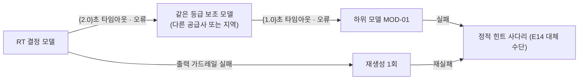

# A11 모델선택·라우팅설계서

> **작성 가이드**
> - **목적**: A10에서 LLM·소형 모델이 필요하다고 정한 단계마다 후보 모델을 같은 평가 세트로 비교해 고르고, 요청을 어느 모델로 보낼지(라우팅), 실패하면 어디로 넘길지(대체 경로), 모델 버전을 어떻게 고정·교체할지 정합니다.
> - **입력**: A10 MD·구성도·데이터 흐름, A06 평가 결과, E14 합격 기준, E13 a6·a7(업체 데이터 조건·국외 이전), A02 지연 예산
> - **게이트**: **G-AI** — A10·A14가 `done`이어야 하며, 이 문서의 모델 결정은 2절 평가 결과 파일로만 확정합니다. A12(비용)는 4절 라우팅 비율을 입력으로 씁니다.
> - **원칙**: 점수·합격률·지연·비용은 `ai_eval.py` 결과 파일에서 옮깁니다. 손 계산·LLM 추정 금지. 단가는 계약 시점에 [확인 필요].
> - **스킬**: `/edpm-ai-design route`, 평가 실행은 `/edpm-eval`
> - **검토 패널 (권장)**: AI 엔지니어, 보안·개인정보 담당, 교과 전문가, 재무
> - **관련 위키**: [[domain/모델선택과라우팅]], [[domain/로컬LLM과온프레미스]], [[domain/AI평가메트릭과AB테스트]], [[domain/LLM비용과토큰과금]], [[domain/AI방식스펙트럼]]
> - 표의 첫 행은 예시 제품 **매스핏**(AI-01 오답 단계별 힌트 해설, MD-01 = M1 + M3 + M7, 민감 입력 M6) 기준입니다. 수치는 모두 [가정]입니다.

---

## 1. 후보 모델 (MOD)

> 구분: 클라우드(대형·중형·소형), 로컬(오픈 모델), 소형 과업 모델(M5), 고전(M2 분류기 등). A10 구성도의 단계마다 후보를 2개 이상 둡니다.

| MOD-ID | 단계 (A10) | 구분 | 모델·버전 | 제공 방식 | 데이터 조건 (학습 미사용·보존·국외) | 라이선스 | 상태 |
|--------|------------|------|-----------|-----------|--------------------------------------|----------|------|
| MOD-01 (예시) | 힌트 문장 생성 | 클라우드 소형 | claude-haiku-5-5 (버전 고정) | API | 학습 미사용·보존 {30}일·국외 [확인 필요: E13 a6·a7] | 상용 API 약관 | 후보 |
| MOD-02 (예시) | 힌트 문장 생성 (어려운 문항) | 클라우드 중형 | claude-sonnet-5-5 | API | 같음 | 같음 | 후보 |
| MOD-03 (예시) | 민감 입력 응답 | 로컬 | {오픈 모델 8B급} on {vLLM / Ollama} | 사내 서버 | 외부 전송 없음 | {라이선스} [확인 필요] | 후보 |
| MOD-04 (예시) | 의도 분류 | 고전 (M2) | {형태소 + 로지스틱 회귀} v1 | 앱 서버 | 외부 전송 없음 | 자체 | 후보 |
| {MOD-0N} | {} | {} | {} | {} | {} | {} | {} |

## 2. 평가 결과 (모델별)

> 같은 프롬프트(PR)·KB 버전·평가 세트로 실행합니다. 수치는 결과 파일에서 스크립트로 옮깁니다.

```
python automation/scripts/ai_eval.py --set 03.docs/3.설계/E14_평가세트.csv \
    --system 03.docs/A.AI/prompts/system_v1.md --model {클라우드 모델} --judge llm
python automation/scripts/ai_eval.py --set ... --target local \
    --endpoint http://localhost:11434/v1 --model {로컬 모델} --judge llm
python automation/scripts/ai_eval.py --set {의도 하위 세트} --target cmd \
    --cmd "python {분류기}.py" --judge exact
```

| MOD-ID | 평가 세트 (건수) | 합격률 | 안전 합격률 | 루브릭 평균 (정확성 / 교육적 적절성) | 지연 p50 / p95 | 요청당 비용 | 결과 파일 | 판정 |
|--------|------------------|--------|-------------|--------------------------------------|----------------|-------------|-----------|------|
| MOD-01 (예시) | T {24}건 + GS {30}건 | {스크립트 값} | {100%} | {} / {} | {} / {} 초 | {원} | `05.outputs/eval_MOD-01_{YYYYMMDD}.csv` | {채택/보류/탈락} |
| {MOD-0N} | {} | {} | {} | {} | {} | {} | {} | {} |

**채택 규칙**: 안전 100%와 E14 항목 기준을 넘는 모델 중 요청당 비용이 가장 낮은 모델을 기본으로 둡니다. 기본 모델이 실패하는 문항 유형만 상위 모델로 보냅니다 [가정].

## 3. 실패 유형별 비교

| 문항 유형 (평가 세트 태그) | MOD-01 | MOD-02 | MOD-03 | 결론 |
|----------------------------|--------|--------|--------|------|
| 대표 오답 유형 (예시) | {합격률} | {} | {} | 기본 모델로 충분 [가정] |
| 다단계 서술형 풀이 | {} | {} | {} | 상위 모델로 라우팅 |
| 정답 요구·우회 | {} | {} | {} | 모델 무관, M1 규칙이 먼저 차단 |
| 범위 밖·위기 신호 | {} | {} | {} | 고정 문구 (A14) |

## 4. 라우팅 규칙 (RT)

> 위에서 아래 순서로 평가하고 처음 맞는 규칙을 적용합니다. 규칙 판단은 코드(규칙·분류기)가 하며 LLM이 스스로 모델을 고르지 않습니다.

| RT-ID | 조건 | 보낼 곳 | 근거 | 예상 비율 |
|-------|------|---------|------|-----------|
| RT-01 (예시) | 입력 가드레일이 자유 서술·민감 신호를 표시 | MOD-03 로컬 또는 고정 문구 | 데이터 민감도 (A10 4절) | {3}% |
| RT-02 (예시) | 의도 = 정답 요구 또는 시도 0회 | M1 규칙 응답 (모델 호출 없음) | GR-01 | {10}% |
| RT-03 (예시) | FAQ·정적 힌트 유사도 ≥ {0.85} | M3 원문 응답 | 비용·검증된 답 | {35}% |
| RT-04 (예시) | 난이도 분류기 = 상 (다단계·서술형) | MOD-02 중형 | 3절 실패 유형 | {12}% |
| RT-05 (예시) | 그 밖의 힌트 요청 | MOD-01 소형 | 2절 채택 규칙 | {40}% |
| RT-06 (예시) | 기관·학습자 월 비용 한도 {90}% 도달 | MOD-01 고정, 이후 정적 힌트 | A12 비용 한도, P09 | - |
| RT-07 | 요금제 등급 = {프리미엄} | {MOD-02 허용 범위 확대} | A12 요금제 | {} |

**난이도 분류기**: {입력 특징: 풀이 줄 수, 문항 난이도 태그(E11), 이전 힌트 단계} → {규칙 / M2 모델}. 오분류율은 A13 OP로 감시합니다.

## 5. 대체 경로와 타임아웃



| 단계 | 타임아웃 | 재시도 | 전환 조건 | 사용자 화면 |
|------|----------|--------|-----------|-------------|
| 기본 모델 (예시) | 첫 토큰 {1.5}초 / 전체 {3}초 | 0회 | 타임아웃·5xx·rate limit | 로딩 표시 (E10) |
| 보조 모델 | {} | {} | {} | {} |
| 정적 힌트 | - | - | 위 모두 실패 | "지금은 기본 힌트로 안내할게요" (A03 고정 문구) |

보조 모델도 2절에서 합격한 모델만 씁니다. 합격하지 않은 모델로의 자동 전환은 금지합니다.

## 6. 버전 고정과 교체 절차

| 항목 | 규칙 |
|------|------|
| 버전 고정 (예시) | 모델 ID를 날짜·버전까지 고정해 설정 파일에 저장. "최신" 별칭 사용 금지 |
| 공급사 지원 종료 공지 | 공지 수신 담당 {AI 엔지니어}, 종료 {60}일 전까지 후속 모델 평가 착수 [가정] |
| 교체 절차 | 1) 후보 등록(MOD) → 2) 2절 평가 재실행 → 3) 기존 대비 안전·루브릭 비열화 확인 → 4) 7절 A/B → 5) ADR 기록 → 6) A13 배포 절차로 전환 |
| 회귀 기준 | 안전 100% 유지, 루브릭 평균 하락 {0.1} 이내, p95 증가 {20}% 이내 [가정] |
| 되돌리기 | 이전 버전 설정을 {30}일 보관, A13 롤백 절차 |

## 7. 모델 A/B

| 실험 | 대조 / 처치 | 배정 단위 | 주 지표 | 가드레일 지표 | 기간·표본 | 결과 |
|------|-------------|-----------|---------|---------------|-----------|------|
| EX-01 (예시) | MOD-02 / MOD-01 (RT-04 구간) | 학습자 (학원 단위 층화) | 힌트 후 재도전 정답률 M-13 | 정답 노출 0건, 오류 신고율, p95 | {2주}, 표본 수는 검정력 계산 스크립트 | {} |

## 8. 재라우팅 트리거 (모니터링 연동)

| 신호 (A13 OP) | 기준 | 조치 |
|---------------|------|------|
| 기본 모델 p95 (예시) | {3초} 초과 15분 지속 | 보조 모델로 자동 전환, 알림 |
| 오류율 | {2}% 초과 | 보조 모델 전환 |
| 오류 신고율·샘플 루브릭 | 기준 대비 {20}% 악화 | RT-04 비율 확대 검토, 재평가 |
| 월 비용 | 예산 {80}% 도달 | RT-06 활성화 (A12, P09) |
| 난이도 분류기 오분류율 | {15}% 초과 | 분류기 재학습 (A13) |

## 서비스 유형별 메모

| 유형 | 라우팅 포인트 |
|------|---------------|
| AT07 소비자 학습앱 (Speak형 말하기 앱) | ASR·발음 평가는 M5 소형 모델 고정, 대화 모델은 첫 토큰 지연 기준으로 선택. 지역 리전 가까운 공급사 우선 |
| AT08 대학 LMS | 기관별 라우팅: 온프레미스 계약 기관은 M6만, 그 외는 클라우드. 기관 설정을 테넌트 단위로 저장 |
| AT01 이러닝 마켓플레이스 | 무료 등급은 소형 모델·FAQ, 유료 등급은 중형 모델 허용 (RT-07), 강사별 Q&A는 강의 근거 RAG |
| AT05·AT06 K-12·학원 | 학생 자유 서술은 로컬 또는 고정 문구, 교사용 생성(AI-02·03)은 상위 모델 허용 |

---

## 완료 체크리스트

- [ ] A10 구성도의 LLM·모델 단계마다 후보 MOD가 2개 이상 있다
- [ ] 후보마다 데이터 조건(학습 미사용·보존·국외 이전)과 라이선스가 확인되었다
- [ ] 평가 수치는 `ai_eval.py` 결과 파일에서 옮겼다 (합격률·루브릭·p50·p95·비용)
- [ ] 라우팅 규칙이 순서대로 정의되고 코드가 판단한다
- [ ] 민감 입력은 로컬·고정 문구로, 비용 한도는 A12·P09와 연결되었다
- [ ] 대체 경로·타임아웃이 있고 합격하지 않은 모델로는 전환하지 않는다
- [ ] 버전 고정, 지원 종료 대응, 교체·회귀 기준, 롤백이 있다
- [ ] 모델 A/B 계획과 재라우팅 트리거가 있다
- [ ] 결정이 ADR로 기록되고 E14 7절·A06 6절과 일치한다
