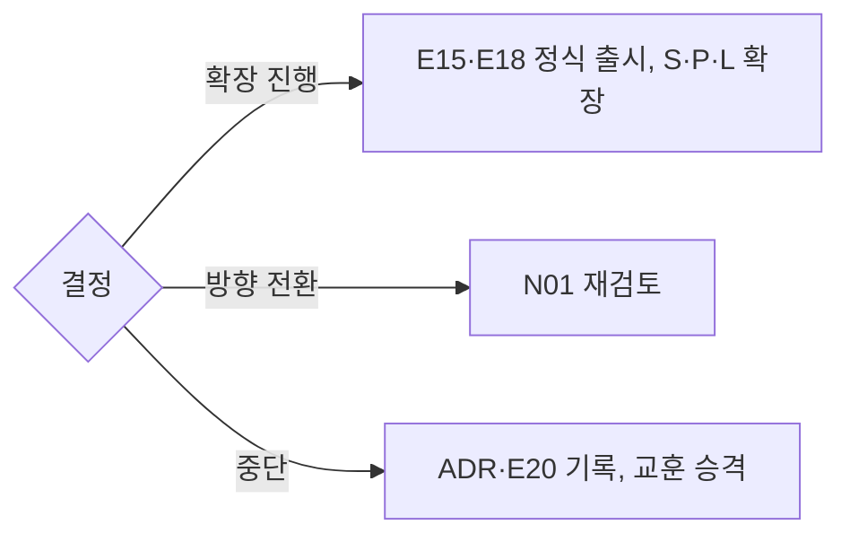

# N04 단계심사보고서

> **작성 가이드**
> - **목적**: 한 단계(탐색·검증·확장)가 끝났을 때 N03에서 미리 정한 GT 기준과 실제 증거를 대조해 **확장 진행 / 방향 전환 / 중단**을 결정합니다. 단계마다 새로 한 벌을 쓰고 이전 보고서는 남겨 둡니다.
> - **입력**: N03(GT 기준·HY 실험), N02(승인 예산·기간), N01(HY 중단 기준), E17 파일럿결과보고서, E16 검증계획서, `05.outputs/`(SQL·스크립트 결과), `01.자료실/현장/`·`데이터/`(가명화된 인터뷰·원자료), `02.wiki/research/`
> - **게이트**: N03이 `done`이어야 합니다. 모든 "실제값"은 SQL·스크립트 경로 또는 인터뷰 근거 위치가 있어야 하며 LLM 추정치는 쓸 수 없습니다. 기준을 N03 이후 바꿨다면 ADR을 링크합니다. 결정은 `02.wiki/decisions/`에 ADR로 남깁니다. **G-STAGE**: 신사업 모드에서 E18(정식 출시) 완료는 이 문서의 결정이 "확장 진행"일 때만 가능합니다.
> - **독자**: 경영진·투자심의. 5절 결정과 근거가 한눈에 보이게 씁니다.
> - **검토 패널 제안**: 경영진, 재무, 학습과학 자문, 데이터 분석가, 현장(교사·원장) 대표
> - **스킬**: `/edpm-venture gate`
> - 예시 행은 가상 신사업 **리딩버디**(유아 영어 리딩 신규 앱 — 만 5~9세, 가정 구독 + 영어학원 B2B2C, AI 음성 리딩 피드백) 기준이며 **모든 수치는 형식을 보여주는 [가정] 값**입니다.

## 1. 심사 개요

| 항목 | 내용 |
|------|------|
| 단계 | {탐색 / 검증 / 확장} |
| 심사 기간 | {YYYY-MM-DD ~ YYYY-MM-DD} |
| 기준 문서 | {N03 버전·확정일} |
| 참여자·표본 | {가구·학원·학습자 수, E17 링크} |
| 예시 | 검증 단계, 20주, 가정 120곳·학원 3곳 (가명화 원자료 `01.자료실/데이터/YYYY-MM-DD_리딩버디파일럿/`) [가정] |

## 2. 기준 대비 증거

| GT-ID | 신호 | 목표 (N03) | 실제 | 증거 (SQL·스크립트·인터뷰 위치) | 판정 |
|-------|------|------------|------|----------------------------------|:---:|
| GT-01 | 리텐션 곡선 평탄화 | {} | {} | {} | {충족/미충족/판단 보류} |
| GT-02 | 활성화 | {} | {} | {} | {} |
| GT-03 | 지불 의향 | {} | {} | {} | {} |
| GT-04 | 학습 효과 신호 | {} | {} | {} | {} |
| GT-05 | 교사·학부모 도입 | {} | {} | {} | {} |
| GT-06 | Sean Ellis (참고) | 40% | {} | {} | {참고} |
| 예시: GT-04 | 학습 효과 | d ≥ 0.2 | d = 0.31, 95% CI [0.05, 0.57] [가정] | `automation/scripts/N03_wcpm.py` → `05.outputs/N03_wcpm_YYYYMMDD_HHMM.csv` | 충족 |
| 예시: GT-05 | 학원 도입 | 3곳 중 2곳 유료 전환 | 1곳 [가정] | 원장 인터뷰 `01.자료실/현장/YYYY-MM-DD_원장인터뷰_A.md` 외 2건 | 미충족 |

- 판단 보류는 표본 부족·측정 오류 등 사유를 적습니다. 학습 효과는 증거 수준([[domain/효과크기와증거수준]])을 함께 적습니다.

## 3. 가설별 학습

| HY-ID | 가설 (N01) | 결과 | 배운 것 | 다음 행동 |
|-------|-----------|------|---------|-----------|
| {HY-} | {} | {지지 / 기각 / 불명확} | {} | {} |
| 예시: HY-05 | 영어학원이 숙제 관리 도구로 좌석료를 낸다 | 불명확 | 원장은 관심 높으나 결정 시점이 신학기 직전에 몰림 [가정] | 학원 채널은 2월 영업 창에 재검증 |

## 4. 비용 집행

| 항목 | 계획 (N02·N03) | 실제 | 차이 | 사유 |
|------|----------------|------|------|------|
| {인건비} | {} | {} | {} | {} |
| {외부 비용} | {} | {} | {} | {} |
| 합계 | {} | {} | {} | {} |
| 예시: 외부 비용 | 음성 AI 호출 {금액} | 계획의 140% [가정] | +40% | 아동 발화 재시도 많음, 단가 협상 필요 |

계산 경로: {`05.outputs/N04_비용집행_YYYYMMDD.csv`} (실제 금액은 `02.wiki/company/`에만)

## 5. 결정

| 결정 | 조건 (N03 7절) | 선택 |
|------|----------------|:---:|
| 확장 진행 | 필수 GT 모두 충족 | {} |
| 방향 전환 | 문제 신호는 있으나 일부 GT 미충족 | {} |
| 중단 | 핵심 GT 미충족 또는 중단 기준 해당 | {} |

| 항목 | 내용 |
|------|------|
| 근거 | {2·3절 요약} |
| 반대 의견·남은 불확실성 | {} |
| ADR | {[[decisions/ADR-0xx]]} |
| 결정자·일자 | {} |
| 예시 | 방향 전환 — B2C 가정 구독은 GT-01·GT-03·GT-04 충족, 학원 B2B2C는 GT-05 미충족. 가정 구독 중심으로 확장 범위를 좁혀 재심 [가정] |

## 6. 다음 단계 자원과 마일스톤

확장 진행 또는 방향 전환일 때 씁니다.

| 마일스톤 | 일자 | 완료 기준 | 담당 | 예산 |
|----------|------|-----------|------|------|
| {} | {} | {} | {} | {} |
| 예시: P01 이용·환불정책 done | YYYY-MM | G-POLICY 충족 | PM | - |
| 예시: E18 정식 출시 | 신학기 전 | G-STAGE·G-EVIDENCE·G-CAL 충족 | PM | {금액} [가정] |

| 인력·자원 | 현재 | 다음 단계 | 근거 |
|-----------|------|-----------|------|
| {} | {} | {} | {} |

## 7. 중단 시 기록과 승격

중단도 성과입니다. 결정과 이유를 ADR과 E20으로 남기고, 회사 기밀을 뺀 일반 교훈만 개인 Brain으로 옮깁니다.

| 항목 | 내용 | 승격 대상 (`/edpm-promote`) |
|------|------|-----------------------------|
| {배운 것} | {} | {예/아니오 — 공개 지식만} |
| 예시 | 만 5~9세 음성 인식은 짧은 단어에서 오인식이 많아 단어 단위 피드백의 신뢰도가 낮음 [가정] | 예 (`domain/` 일반화, 수치·벤더명 제외) |
| 예시 | 우리 회사 제휴 학원별 전환 현황 | 아니오 (회사 기밀) |

## 서비스 유형별 메모

| 유형 | 이 문서가 달라지는 점 |
|------|------------------------|
| B2B LMS 신사업 (AT02) | 증거 단위가 계약·PoC 전환. 표본이 작아 고객 인터뷰와 계약 의향서를 근거로 쓰되 정량 GT와 구분해 판정 |
| 소비자 앱 (AT07) | 코호트 리텐션과 유료 전환이 중심. 확장 시 마케팅 CAC 검증을 다음 단계 마일스톤에 둠 |
| K-12 공교육 (AT05) | 학기 단위로 심사 시점이 정해짐. 확장 조건에 조달 등록·교육청 협의 진척을 포함 |

## 완료 체크리스트

- [ ] 단계와 기준 문서(N03 버전)가 명시되었다
- [ ] 모든 GT에 목표·실제·증거 경로·판정이 있다 (LLM 추정치 없음)
- [ ] 기준 변경이 있으면 ADR이 링크되었다
- [ ] 가설별로 지지·기각·불명확과 배운 것이 정리되었다
- [ ] 계획 대비 비용 차이와 사유가 있다
- [ ] 결정(확장 진행 / 방향 전환 / 중단)과 근거·ADR이 기록되었다
- [ ] 확장 진행이 아니면 E18을 완료하지 않는다 (G-STAGE)
- [ ] 다음 단계 마일스톤에 G-POLICY·G-EVIDENCE·G-CAL 충족 시점이 있다
- [ ] 중단 시 승격할 교훈과 제외할 기밀을 구분했다
