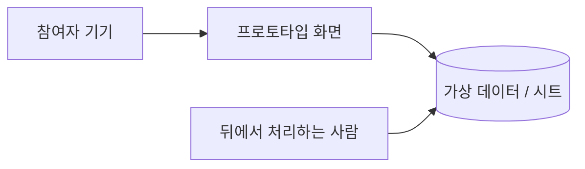

# V02 프로토타입빌드기록 — {PT-ID} {이름}

> **작성 가이드**
> - **목적**: 무엇을 어떻게 만들었는지, 계획(V01)과 무엇이 달라졌는지, 운영 제품으로 가져가면 무엇을 다시 만들어야 하는지 남깁니다. 테스트 참여자와 개발팀이 같은 정보를 봅니다.
> - **입력**: V01, 코드 저장소·배포 URL, 빌드 중 결정(ADR)
> - **게이트 (G-PROTO)**: V01이 `done`이어야 P3·P4 빌드를 시작합니다. 테스트 전에 7절 점검을 마칩니다.
> - **분량**: 한 쪽. P0·P1은 1·2·7절만 써도 됩니다.
> - **스킬**: `/edpm-proto build`
> - 예시는 가상 신사업 **리딩버디** PT-01이며 수치는 [가정]입니다.

## 1. 요약

| 항목 | 내용 |
|------|------|
| 충실도 | {P0~P4} |
| 결과물 | {파일 경로 / 배포 URL (접근 방법은 따로 전달)} |
| 코드 | {`06.prototypes/PT-01_이름/` / 저장소 URL, 기준 커밋} |
| 빌드 기간 | 계획 {n일} / 실제 {n일} |
| 예시 | P1+P2 · `06.prototypes/PT-01_음성피드백/index.html` + 교사용 피드백 입력 시트 · 계획 5일 / 실제 4일 |

## 2. 범위: 계획 대비

| V01 항목 | 결과 | 비고 |
|----------|------|------|
| {진짜로 만들 것} | {구현 / 축소 / 제외} | {} |
| {가짜로 둘 것} | {가짜 방식} | {} |
| 예시: 피드백 확인 화면 | 구현 | 단어별 색 표시, 다시 읽기 버튼 |
| 예시: 피드백 생성 | 가짜 (교사 수동) | 교사가 녹음 듣고 시트에 입력, 앱이 1분마다 읽어옴 |

## 3. 구성

| 구성 요소 | 선택 | 비용 | 운영 승격 시 |
|-----------|------|------|--------------|
| {화면} | {} | {} | {재사용 / 다시 만듦} |
| {데이터} | {} | {} | {} |
| {AI·외부 API} | {} | {} | {} |

## 4. 데이터

| 항목 | 내용 |
|------|------|
| 사용 데이터 | {가상 데이터 생성 방법 / 공개 콘텐츠} |
| 참여자가 만드는 데이터 | {녹음·입력·로그} — 저장 위치 {}, 파기일 {} |
| 외부 전송 | {없음 / 대상·항목} |

## 5. 알려진 한계와 기술 부채

운영 제품으로 옮길 때 그대로 쓰면 안 되는 것을 적습니다. V03 이관 판단의 근거입니다.

| 항목 | 한계 | 운영에서 필요한 것 |
|------|------|--------------------|
| {인증} | {테스트 코드 로그인} | {보호자 동의 연동 가입} |
| {보안} | {} | {} |
| {성능·규모} | {} | {} |
| {접근성} | {} | {} |

## 6. 실행 방법

{로컬 실행 명령, 배포 방법, 관리 화면 접근, 초기화 방법 — 길면 코드 폴더 README로 링크}

## 7. 테스트 준비 점검

- [ ] 핵심 과제 시나리오를 처음부터 끝까지 리허설했다 (기기·브라우저 {})
- [ ] 자동 점검 (선택): `webapp-testing`(화면 E2E) 스모크 또는 `/edpm-eval`(AI 응답) 결과 {경로}
- [ ] V01 4절 신호를 측정할 수 있다 (이벤트 로그·관찰 기록지)
- [ ] V01 7절 데이터·안전 항목이 실제 빌드에서도 지켜진다 (접근 제한, 가상 데이터, 결제 차단)
- [ ] 문제가 생기면 되돌릴 방법이 있다 (이전 커밋, 수동 대체)

## 완료 체크리스트

- [ ] 결과물 위치와 접근 방법이 있다
- [ ] 계획 대비 구현·가짜·제외가 표로 정리되었다
- [ ] 운영 승격 시 다시 만들어야 할 항목이 있다
- [ ] 테스트 준비 점검을 마쳤다
